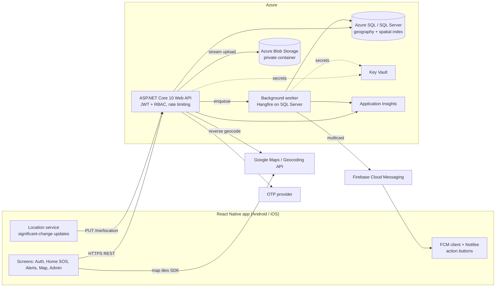
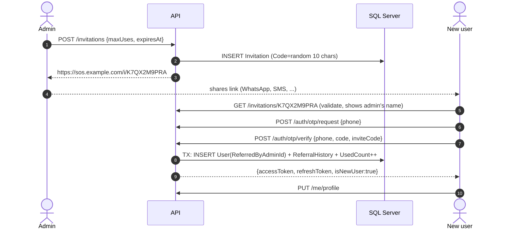
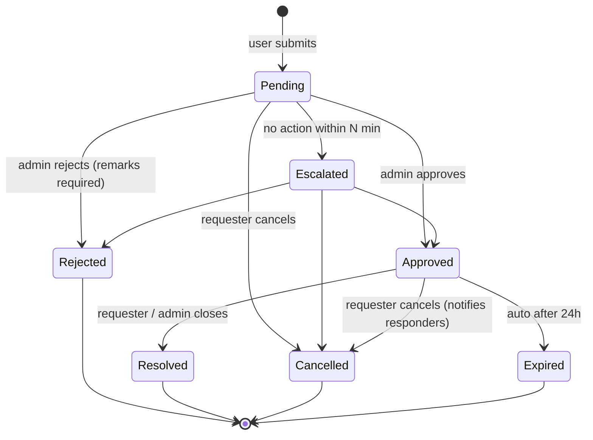
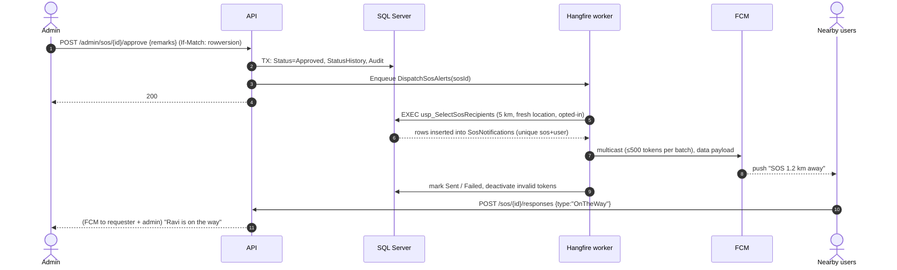
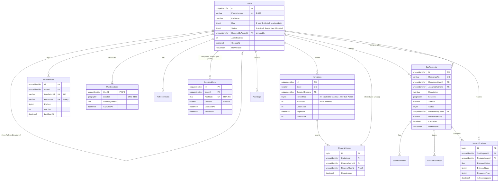

# Community SOS — Solution Architecture (Phase 1)

> Status: **Draft v0.1** — pending answers to the open questions in §10.
> Defaults marked **[ASSUMPTION]** will be used unless changed.

---

## 1. Requirements analysis

### 1.1 Actors and roles

| Role | How you get it | Key permissions |
|---|---|---|
| **MasterAdmin** (3) | Seeded at deployment. Exactly one. | Everything: invites Sub-Admins, sees all users and all SOS, can act on any SOS (including escalated ones), global dashboard, audit log, suspends users. |
| **SubAdmin** (2) | **Joined through the Master Admin's invite link.** | Creates invite links for Users, sees own referred Users, approves/rejects SOS raised by own Users, own-scope dashboard. Their own SOS is **auto-approved**. |
| **User** (1) | **Joined through a Sub-Admin's invite link.** | Raises SOS (needs approval), receives nearby alerts, acknowledges/responds, manages profile. Cannot invite. |

```
Master Admin ──invites──► Sub-Admin ──invites──► User
```

**SOS routing rules (confirmed)**

| Requester | Assigned to | Review |
|---|---|---|
| User | The Sub-Admin who invited them | Needs approval. Escalates to the Master Admin after 3 min. If that Sub-Admin is suspended, it goes straight to the Master Admin. |
| SubAdmin | Master Admin (visibility only) | **Auto-approved**; the 5 km alert goes out immediately |
| MasterAdmin | Master Admin | Auto-approved |

### 1.2 Gaps and risks in the brief

1. **Approval delay is a life-safety risk.** Every SOS waits on one human (the referring Admin). If that Admin is asleep, nearby users are never alerted. The design includes:
   - an **escalation timer**: an SOS still pending after *N* minutes (default 3) goes to the MasterAdmin as well;
   - an **"Call emergency services"** action on the SOS screen. The app supplements official emergency services and does not replace them.
2. **"Users within 5 KM" needs the users' locations.** Something has to keep each user's last known location current, which needs background location permission. That is the most privacy-sensitive part of the system and the part app stores review most closely (Google Play's background-location declaration and iOS "Always" permission justification). The design stores **only the latest point per user, with no history**, refreshed on significant movement, and ignores points older than a freshness window.
3. **Deferred deep links.** Firebase Dynamic Links was shut down in Aug 2025. Invitation links therefore use our own domain with Android App Links and iOS Universal Links. If the app is not installed yet, the landing page shows the invite code, which the app takes in during sign-up (Android can also read it through the Play Install Referrer API).
4. **Duplicate notifications** can come from retries, double-tapped approvals, several devices per user, and token rotation. Prevention is layered (see §6.3).
5. **Licensing.** MediatR and AutoMapper moved to commercial licences in 2025. This design uses plain application services with FluentValidation and manual or source-generated (Mapperly) mapping, so there are no licence costs.

---

## 2. High-level architecture



### 2.1 Technology choices

| Concern | Choice | Reason |
|---|---|---|
| Runtime | **.NET 10 (LTS)**, ASP.NET Core Web API (controllers) | LTS support; controllers fit a large, versioned API. |
| ORM | **EF Core 10 + NetTopologySuite** (`UseNetTopologySuite`) | Maps `geography` to `Point`; spatial LINQ is translated to SQL Server. |
| DB | **SQL Server 2022 / Azure SQL** | `geography` type plus spatial indexes for the 5 km search. |
| Background jobs | **Hangfire** (SQL Server storage) | Persistent retries, delayed jobs (escalation timer), dashboard; no extra infrastructure. |
| Validation | FluentValidation | |
| Logging | Serilog → Application Insights (+ console) | Structured logs with a correlation ID. |
| Auth | JWT access token (15 min) + rotating refresh token (30 days, stored hashed) | |
| Push | FirebaseAdmin .NET SDK, `SendEachForMulticastAsync` (500 tokens/batch) | |
| Mobile | **React Native (New Architecture) via Expo with dev builds / prebuild** | Native modules (Firebase, Maps) still work, and OTA updates and EAS builds are simpler. Bare RN CLI also works (open question Q10). |
| Mobile libraries | React Navigation, TanStack Query, Zustand, react-hook-form + zod, `@react-native-firebase/messaging`, Notifee, `react-native-maps` (Google provider), `expo-location`, `expo-secure-store` | |

### 2.2 Clean Architecture layers (backend)

```
Api  ──►  Application  ──►  Domain
 │             ▲
 └──► Infrastructure (implements Application interfaces)
```

- **Domain**: entities, enums, value objects (`GeoPoint`, `PhoneNumber`), domain rules (SOS state machine), domain exceptions. No framework dependencies apart from NetTopologySuite geometry types.
- **Application**: use-case services (`SosService`, `ReferralService`, …), DTOs, validators, and interfaces (`IAppDbContext`, `IBlobStorage`, `IPushSender`, `IOtpSender`, `IGeocoder`, `IClock`, `ICurrentUser`). Holds all business logic.
- **Infrastructure**: EF Core DbContext, configurations, migrations, Blob, FCM, SMS, Geocoding, Hangfire jobs, JWT issuing.
- **Api**: controllers, auth policies, middleware (exception → ProblemDetails, correlation ID), rate limiting, Swagger, health checks.

---

## 3. Core workflows

### 3.1 Invitation → registration



Rules:
- `ReferredByAdminId` is set **once, at creation**, and never changes. This is enforced in the domain model (no setter) and by a DB trigger that blocks updates.
- An existing user who opens a new invite link just logs in; the original mapping stays.
- An invite is valid if it is not revoked, not expired, and `UsedCount < MaxUses`. The increment is atomic (`UPDATE … WHERE UsedCount < MaxUses`).

### 3.2 SOS lifecycle



### 3.3 Approval → 5 km fan-out



---

## 4. Database design

### 4.1 ER diagram



### 4.2 Table specifications

All timestamps are `datetime2(3)` in **UTC**. Primary keys are `uniqueidentifier DEFAULT NEWSEQUENTIALID()`, which is safe to expose in URLs and avoids index fragmentation. High-volume append-only tables use `bigint IDENTITY`.

**Users**
| Column | Type | Notes |
|---|---|---|
| Id | uniqueidentifier PK | |
| PhoneNumber | varchar(16) NOT NULL | E.164, **UNIQUE** |
| PhoneVerifiedAt | datetime2 NULL | |
| FullName | nvarchar(100) NULL | Filled in during profile setup |
| Email | nvarchar(256) NULL | |
| ProfilePhotoBlob | varchar(300) NULL | Blob name, never a public URL |
| BloodGroup, EmergencyContactName, EmergencyContactPhone | | Optional, sensitive, shown only to the reviewing admin |
| Role | tinyint NOT NULL | CHECK IN (1,2,3); **filtered unique index** `WHERE Role=3` guarantees a single MasterAdmin |
| Status | tinyint NOT NULL | |
| ReferredByAdminId | uniqueidentifier NULL FK→Users | NULL only for the MasterAdmin; **immutable (trigger)** |
| AlertsEnabled | bit NOT NULL DEFAULT 1 | Opt-out of receiving nearby alerts |
| LocationSharingEnabled | bit NOT NULL DEFAULT 0 | Explicit consent flag |
| LastLoginAt, CreatedAt, UpdatedAt | datetime2 | |
| *(no IsDeleted)* | | Deletion = `Status = 3` plus personal data anonymised; the row is kept for referral and SOS history |
| RowVersion | rowversion | Optimistic concurrency |

Indexes: `UX_Users_Phone`, `IX_Users_ReferredByAdminId (Status) INCLUDE (CreatedAt)`, `UX_Users_SingleMaster` (filtered).

**OtpChallenges**: *removed (Q7). Firebase Phone Auth sends and verifies the OTP; the API stores `Users.FirebaseUid`.*

**RefreshTokens**: Id, UserId FK, TokenHash (SHA-256, UNIQUE), DeviceId, ExpiresAt, RevokedAt, ReplacedByTokenId, CreatedAt. If a revoked token is used again, the whole token family is revoked (theft detection).

**Invitations**: Id, Code varchar(16) UNIQUE (crypto-random, unambiguous alphabet), CreatedByAdminId FK, Label nvarchar(100), MaxUses int NULL, UsedCount int, ExpiresAt NULL, IsRevoked, CreatedAt. Index `(CreatedByAdminId, CreatedAt DESC)`.

**ReferralHistory**: Id bigint, InvitationId FK, ReferrerAdminId FK, ReferredUserId FK **UNIQUE** (one permanent mapping), RegisteredAt, DeviceInfo, IpAddress. Append-only (no UPDATE/DELETE permission granted to the app login).

**UserDevices**: Id, UserId FK, InstallationId varchar(200) **UNIQUE** (Firebase Installation ID; current builds), FcmToken varchar(512) **UNIQUE** (legacy builds), exactly one of the two (`CK_UserDevices_Target`), Platform (1 Android, 2 iOS), AppVersion, IsActive, LastSeenAt, CreatedAt. Either identifier moves to whichever user signed in last on that phone. Index `(UserId) WHERE IsActive=1`.

**LocationKeys** (Module 6): Id, UserId FK, KeyHash char(64) **UNIQUE** (SHA-256 of an `lk_`-prefixed 256-bit secret), DeviceId varchar(100) (the app install id its refresh tokens carry), CreatedAt, LastUsedAt, RevokedAt, RevokedReason. One active key per (UserId, DeviceId), filtered unique. It can only call `PUT /location/background`, and only while that phone holds an active refresh token. See [06](06-background-location.md).

**UserLocations** (one row per user, last-known only)
| Column | Type | Notes |
|---|---|---|
| UserId | PK, FK | |
| Location | geography NOT NULL | Point, SRID 4326 |
| AccuracyMeters | float | Points with accuracy > 500 m are ignored |
| CapturedAt | datetime2 | Device time, validated to be ≤ now + 2 min |
| UpdatedAt | datetime2 | |

`SPATIAL INDEX SIX_UserLocations_Location ON UserLocations(Location) USING GEOGRAPHY_AUTO_GRID`, plus `IX_UserLocations_CapturedAt`.

**SosRequests**
| Column | Type | Notes |
|---|---|---|
| Id | PK | |
| ReferenceNo | varchar(20) UNIQUE | `SOS-20261114-000123` (from a SEQUENCE) |
| ClientRequestId | uniqueidentifier UNIQUE | **Idempotency key** sent by the app, so a retried submit cannot create a duplicate SOS |
| RequesterUserId | FK→Users | |
| AssignedAdminId | FK→Users | Copied from the requester's `ReferredByAdminId` at creation time |
| Category | tinyint | Medical / Fire / Accident / Crime / Other **[ASSUMPTION]** |
| Description | nvarchar(1000) | |
| Location | geography NOT NULL | |
| Latitude, Longitude | decimal(9,6) | Persisted for display and export |
| AccuracyMeters | float | |
| Address | nvarchar(500) NULL | Reverse-geocoded on the server asynchronously, so a geocoding failure never blocks an SOS |
| ClientCapturedAt, CreatedAt | datetime2 | |
| Status | tinyint | See state machine |
| EscalatedAt | datetime2 NULL | |
| ReviewedByUserId, ReviewedAt, ReviewRemarks | | |
| RecipientCount | int | Denormalised for the dashboard |
| ClosedAt | datetime2 NULL | |
| RowVersion | rowversion | Prevents two admins approving at the same moment |

Indexes: `(AssignedAdminId, Status, CreatedAt DESC)` for the admin queue, `(RequesterUserId, CreatedAt DESC)`, `(Status, CreatedAt)` for the escalation and expiry jobs, and a spatial index on `Location` for the dashboard map and heat-map.

**SosAttachments**: Id, SosRequestId FK, BlobName, ContentType, SizeBytes, Sha256, Width, Height, UploadedAt. Maximum 5 per SOS.

**SosStatusHistory**: Id bigint, SosRequestId FK, FromStatus, ToStatus, ChangedByUserId NULL (NULL = system), Remarks, ChangedAt. Append-only.

**SosNotifications** (recipients and responses)
| Column | Type | Notes |
|---|---|---|
| Id | bigint PK | |
| SosRequestId, RecipientUserId | FK | **UNIQUE (SosRequestId, RecipientUserId)**: the core duplicate guard |
| DistanceMeters | float | |
| DeliveryStatus | tinyint | Queued / Sent / Failed / NoDevice |
| SentAt, DeliveredAt | datetime2 | |
| AcknowledgedAt | datetime2 | "Seen" |
| ResponseType | tinyint | None / CanHelp / OnTheWay / CannotHelp / Arrived |
| RespondedAt, ResponseNote | | |

Index `(RecipientUserId, CreatedAt DESC)` for "my alerts".

**AuditLogs**: Id bigint, UserId NULL, Action varchar(50), EntityName, EntityId, OldValues nvarchar(max) JSON, NewValues JSON, IpAddress, UserAgent, CorrelationId, CreatedAt. Written automatically by an EF Core `SaveChangesInterceptor` for audited entities and explicitly for security events (login, OTP failure, role change). Partitioned by month or kept with a retention policy.

### 4.3 Stored procedures (only where they help)

EF Core LINQ covers most queries. Stored procedures are used where set-based T-SQL is clearly better:

| Procedure | Purpose |
|---|---|
| `usp_SelectSosRecipients @SosId, @RadiusMeters=5000, @FreshHours=12` | Spatial search plus `INSERT … SosNotifications` in one set-based statement, skipping existing rows (idempotent). Returns recipients and their active tokens. |
| `usp_GetDashboardStats @AdminId NULL` | All dashboard counters in one round trip (NULL = global for the MasterAdmin). |
| ~~`usp_ExpireStaleSos`~~ | Replaced by the recurring domain job `ExpireStaleSosJob` (Module 3e). |

Core of the 5 km query (uses the spatial index):

```sql
DECLARE @p geography = (SELECT Location FROM dbo.SosRequests WHERE Id = @SosId);

INSERT INTO dbo.SosNotifications (SosRequestId, RecipientUserId, DistanceMeters, DeliveryStatus, CreatedAt)
SELECT @SosId, ul.UserId, ul.Location.STDistance(@p), 1, SYSUTCDATETIME()
FROM dbo.UserLocations ul WITH (INDEX(SIX_UserLocations_Location))
JOIN dbo.Users u ON u.Id = ul.UserId
WHERE ul.Location.STDistance(@p) <= @RadiusMeters          -- sargable for spatial index
  AND ul.CapturedAt >= DATEADD(HOUR, -@FreshHours, SYSUTCDATETIME())
  AND u.Status = 1 AND u.AlertsEnabled = 1 AND u.LocationSharingEnabled = 1
  AND u.Id <> (SELECT RequesterUserId FROM dbo.SosRequests WHERE Id = @SosId)
  AND NOT EXISTS (SELECT 1 FROM dbo.SosNotifications n
                  WHERE n.SosRequestId = @SosId AND n.RecipientUserId = ul.UserId);
```

---

## 5. API surface (overview)

Base path `/api/v1`. Errors use RFC 7807 `application/problem+json`. Full request and response JSON examples come with each module.

| Area | Endpoints | Roles |
|---|---|---|
| Auth | `POST auth/otp/request`, `POST auth/otp/verify`, `POST auth/refresh`, `POST auth/logout` | Anonymous / any |
| Invitations | `GET invitations/{code}` (public preview), `POST invitations`, `GET invitations`, `DELETE invitations/{id}` | Admin+ |
| Me | `GET/PUT me/profile`, `POST me/photo`, `PUT me/location`, `PUT me/preferences`, `POST/DELETE me/devices`, `DELETE me` | User+ |
| SOS (user) | `POST sos` (multipart: JSON + ≤5 images), `GET sos/mine`, `GET sos/{id}`, `POST sos/{id}/cancel`, `POST sos/{id}/resolve` | User+ |
| Alerts | `GET alerts`, `POST alerts/{sosId}/ack`, `POST alerts/{sosId}/response` | User+ (recipient only) |
| Admin SOS | `GET admin/sos?status=`, `POST admin/sos/{id}/approve`, `POST admin/sos/{id}/reject` | Admin (own scope), MasterAdmin (all) |
| Admin users | `GET admin/users`, `GET admin/referrals`, `PUT admin/users/{id}/role`, `PUT admin/users/{id}/status` | MasterAdmin (role/status), Admin (read own) |
| Dashboard | `GET admin/dashboard`, `GET admin/sos/map?bbox=` | Admin+ |
| Files | `GET files/sos/{attachmentId}` → 302 to a 5-minute read-only SAS URL | Requester, assigned admin, MasterAdmin, approved recipients |

Authorization is **resource-based**, not role-only. For example, an Admin can approve an SOS only if `AssignedAdminId == currentUser` (or the SOS is escalated and the caller is the MasterAdmin).

---

## 6. Cross-cutting design

### 6.1 Security
- HTTPS only, HSTS. Secrets live in Key Vault and are reached through Managed Identity; there are no keys in config or in the mobile app.
- JWT signed with an asymmetric key (RS256), short-lived; refresh tokens rotate and are stored hashed. Tokens are kept in the device keystore/keychain (`expo-secure-store`).
- ASP.NET rate limiter on OTP, SOS create (max 3 per 10 min per user), and location updates.
- Input validation (FluentValidation) on every request, with a global exception middleware that hides internals.
- SQL login with least privilege: no DDL, and no UPDATE/DELETE on append-only tables.
- **Image uploads**: max 5 MB each and 5 per SOS. The real type is checked from the file's magic bytes (JPEG/PNG/HEIC/WebP). Images are **re-encoded server-side** (ImageSharp/SkiaSharp), which strips EXIF metadata and any embedded payload. Files go into a **private** container under a random GUID name and are read only through short-lived SAS URLs. Microsoft Defender for Storage malware scanning is optional.

### 6.2 Privacy (location and emergency data)
- Location sharing is **opt-in** with clear purpose text. Only the **latest** point is stored (no movement history) and it is ignored after 12 h. Users can switch it off at any time; doing so deletes the row.
- Alert recipients see only the **SOS location, category, description, and photos**, plus the requester's first name **[ASSUMPTION]**. They never see the phone number or other users' locations. Distances are shown rounded (for example "1.2 km").
- Recipients can see SOS details only while they hold a `SosNotifications` row and the SOS is active.
- Retention: SOS media is deleted N days after closure **[ASSUMPTION 90]**; audit logs are kept 1 year. Account deletion anonymises personal data.
#### 6.2.1 Regulatory compliance (India first, GDPR next)

Engineering summary, not legal advice. Have counsel review the Privacy Notice and Terms before launch.

| Obligation | Source | How the system meets it | Module |
|---|---|---|---|
| Clear notice plus specific, informed consent per purpose | DPDP s.5–6; GDPR Art. 6–7 | Separate consents: Terms+Privacy, Location, Health data. Notice in English plus regional languages (Hindi, Gujarati, …). | 2 (ledger), 4 (UI) |
| Proof of consent | DPDP s.6(10); GDPR Art. 7(1) | Append-only `UserConsents` table (version, timestamp, IP, client); trigger blocks edits | 2 ✅ |
| Withdrawal as easy as granting | DPDP s.6(4); GDPR Art. 7(3) | Toggles in Settings write a `Granted = 0` row. Withdrawing location deletes the `UserLocations` row at once. | 2 ✅, 3b |
| Children (under 18) need verifiable parental consent | DPDP s.9 | **App is 18+ only**: an adult declaration is required at sign-up (`AdultConfirmedAt`) and the domain rejects registration without it | 2 ✅ |
| Health data is a special category (blood group, emergency contact) | GDPR Art. 9 | Optional fields, saved only with the `HealthData` consent; shown only to the reviewing admin | 3b |
| Data minimisation / storage limitation | DPDP s.8(7); GDPR Art. 5 | Latest location point only, ignored after 12 h; SOS photos deleted 90 days after closure; account deletion anonymises the row | 2 ✅, 7 (purge job) |
| Rights to access, correction, erasure, grievance redressal | DPDP s.11–13; GDPR Art. 15–17 | `GET /me/data-export`, `PUT /me/profile`, `DELETE /me`, in-app grievance contact | 3b |
| Data portability | GDPR Art. 20 | Same export, as machine-readable JSON | 3b |
| Reasonable security safeguards | DPDP s.8(5); GDPR Art. 32 | TLS, encryption at rest (Azure SQL TDE, Storage SSE), Key Vault, least-privilege SQL login, audit log | 3a, 7 |
| Breach notification | DPDP Rules: Board + affected users without delay, detailed report within 72 h; **CERT-In: 6 h**; GDPR: 72 h to the supervisory authority | Incident runbook plus App Insights alerts | 7 |
| Log retention | DPDP Rules: 1 year; CERT-In: 180 days, kept in India | `AuditLogs` and App Insights kept 1 year in Central India | 2 ✅, 7 |
| EU data residency and DPIA (on EU expansion) | GDPR Art. 35, Ch. V | Separate EU deployment (West Europe); DPIA for location tracking; EU representative | Later |

Most DPDP Rules obligations phase in through about May 2027. Building them in now avoids a retrofit.

**Emergency numbers (India):** the SOS screen always offers **112** (national ERSS), with **108** (ambulance), **101** (fire) and **100** (police) as secondary options.

### 6.3 Duplicate-notification prevention
1. `SosRequests.ClientRequestId` UNIQUE: a retried submit is a no-op.
2. Status transition `Pending → Approved` happens through a row-version check, so it can only happen once.
3. The Hangfire job is keyed by `sosId` and the recipient insert is idempotent (`UNIQUE (SosRequestId, RecipientUserId)` + `NOT EXISTS`). A retried job sends only to rows still `Queued`/`Failed`.
4. Devices are deduplicated per user. `InstallationId` and `FcmToken` are UNIQUE, so one phone never receives the same alert twice under two accounts.
5. The FCM message uses `collapse_key`/`apns-collapse-id = sosId`, and the app ignores an `sosId` it has already shown (local cache).

### 6.4 Observability and errors
Serilog structured logs carry `CorrelationId`, `UserId`, and `SosId`. Application Insights holds traces and metrics (time to approve, fan-out duration, FCM failure rate). Health checks cover `/health/live` and `/health/ready` (SQL, Blob). Alerts fire on escalation count and FCM failure spikes.

### 6.5 Scalability
The API is stateless, so App Service can scale out. The spatial index keeps the 5 km query fast at millions of users. Fan-out runs in the worker, which can be scaled separately. Read-heavy dashboard queries can move to a read replica later.

---

## 7. Project folder structure

```
Mehul_First_SOS_App/
├── docs/
│   ├── 01-architecture.md
│   └── api/                         # per-module API contracts with JSON examples
├── database/
│   ├── scripts/                     # idempotent DDL reference (EF migrations are source of truth)
│   │   ├── 001_schema.sql
│   │   ├── 010_spatial_indexes.sql
│   │   ├── 020_triggers.sql
│   │   └── 030_stored_procedures.sql
│   └── seed/
│       └── seed_master_admin.sql
├── backend/
│   ├── CommunitySos.sln
│   ├── Directory.Build.props        # nullable, warnings-as-errors, analyzers
│   ├── Directory.Packages.props     # central package versions
│   ├── src/
│   │   ├── CommunitySos.Domain/
│   │   │   ├── Common/              # BaseEntity, IAuditable, DomainException
│   │   │   ├── Entities/            # User, Invitation, ReferralHistory, SosRequest, ...
│   │   │   ├── Enums/               # UserRole, SosStatus, ResponseType, ...
│   │   │   └── ValueObjects/        # PhoneNumber, GeoCoordinate
│   │   ├── CommunitySos.Application/
│   │   │   ├── Abstractions/        # IAppDbContext, IPushSender, IBlobStorage, IOtpSender, IGeocoder, ICurrentUser, IClock
│   │   │   ├── Common/              # Result<T>, PagedList, exceptions, mapping
│   │   │   ├── Features/
│   │   │   │   ├── Auth/            # DTOs, validators, AuthService
│   │   │   │   ├── Invitations/
│   │   │   │   ├── Users/
│   │   │   │   ├── Sos/
│   │   │   │   ├── Alerts/
│   │   │   │   └── Dashboard/
│   │   │   └── DependencyInjection.cs
│   │   ├── CommunitySos.Infrastructure/
│   │   │   ├── Persistence/
│   │   │   │   ├── AppDbContext.cs
│   │   │   │   ├── Configurations/  # IEntityTypeConfiguration per entity
│   │   │   │   ├── Interceptors/    # AuditInterceptor, TimestampInterceptor
│   │   │   │   ├── Migrations/
│   │   │   │   └── Seed/
│   │   │   ├── Identity/            # JwtTokenService, RefreshTokenService, OtpHasher
│   │   │   ├── Notifications/       # FcmPushSender
│   │   │   ├── Storage/             # AzureBlobStorage, ImageSanitizer
│   │   │   ├── Sms/                 # IOtpSender implementations
│   │   │   ├── Geo/                 # GoogleGeocoder
│   │   │   ├── Jobs/                # DispatchSosAlertsJob, EscalateSosJob, ExpireSosJob
│   │   │   └── DependencyInjection.cs
│   │   └── CommunitySos.Api/
│   │       ├── Controllers/
│   │       ├── Authorization/       # policies, resource handlers
│   │       ├── Middleware/          # ExceptionHandling, CorrelationId
│   │       ├── Extensions/
│   │       ├── appsettings.json
│   │       └── Program.cs
│   └── tests/
│       ├── CommunitySos.Domain.Tests/
│       ├── CommunitySos.Application.Tests/
│       └── CommunitySos.Api.IntegrationTests/   # WebApplicationFactory + Testcontainers (SQL Server)
├── mobile/                          # Expo SDK 58, see docs/04a-mobile-foundation.md
│   ├── app.config.ts                # variants, deep links, config plugins
│   ├── eas.json
│   └── src/
│       ├── app/                     # Expo Router routes; _layout.tsx holds all access guards
│       │   ├── (auth)/              # welcome, phone, otp, join
│       │   ├── (app)/               # signed-in area: home, SOS (4b), admin (4c)
│       │   └── i/[code].tsx         # invite deep link
│       ├── api/                     # fetch client (refresh + retry), problem+json errors, endpoints, wire types
│       ├── auth/                    # token manager, session lifecycle, Firebase phone auth
│       ├── features/                # feature hooks and components
│       ├── i18n/                    # type-checked strings
│       ├── lib/                     # secure storage, device info, parsers
│       └── ui/                      # theme and accessible base components
├── web/invite-site/                 # /i/{code} landing page + .well-known (App Links / Universal Links)
├── infra/bicep/                     # App Service, Azure SQL, Storage, Key Vault, App Insights, alerts, invite site
├── .github/workflows/               # CI; deploy (build → staging → prod, migrate, slot swap); EAS mobile release
└── README.md
```

---

## 8. Module delivery plan

| # | Module | Output |
|---|---|---|
| 1 | Architecture (this doc) | Approved design and answered questions |
| 2 | Database | Domain entities, EF configurations, initial migration, spatial indexes, trigger, stored procedures, seed of the MasterAdmin |
| 3a | API foundation | Solution skeleton, DI, Serilog, exception middleware, JWT, auth policies, Swagger, health checks |
| 3b | Auth + OTP + Profile | Endpoints, JSON examples, tests |
| 3c | Invitations + Referrals | |
| 3d | SOS + secure image upload | |
| 3e | Admin review, escalation, dashboard | |
| 4 | React Native app | Project setup → auth → home/SOS → alerts → admin screens |
| 5 | FCM integration | Server dispatch job + client handling and action buttons |
| 6 | Background location ✅ | Location keys, movement updates + geofence + check-in, disclosure and permission flow ([06](06-background-location.md)) |
| 7 | Testing and deployment ✅ | SQL Server tests (Testcontainers) incl. 10k-member fan-out, retention purge, Bicep, GitHub Actions, release checklist ([07](07-testing-deployment.md), [08](08-release-checklist.md)) |

---

## 9. Non-functional targets [ASSUMPTION]

| Metric | Target |
|---|---|
| SOS submit → admin notified | < 5 s |
| Approve → nearby pushes sent | < 10 s for 10k recipients |
| API p95 latency | < 300 ms |
| Availability | 99.9% |

---

## 10. Decisions log

| # | Decision (2026-11-14) |
|---|---|
| Q1 | 3 levels: Master Admin → Sub-Admin → User. Each invite link's role is set by its creator's role. Users cannot invite. |
| Q1b | A Sub-Admin's (and the Master Admin's) own SOS is auto-approved. |
| Q2 | An invite is required to register. |
| Q3 | A User's SOS escalates to the Master Admin after 3 minutes. No auto-approval for Users. |
| Q4 | Alerts go to all eligible users within 5 km, regardless of community. |
| Q5 | Live last-known location, opt-in, latest point only, 12 h freshness. |
| Q6 | Admin screens live inside the same mobile app, shown by role. |
| Q7 | **Firebase Phone Auth** for OTP. The API verifies the Firebase ID token and then issues its own JWT. There is no OTP table. |
| Q8 | **Launch in India** (DPDP Act 2023 + DPDP Rules 2025, CERT-In directions); **GDPR compliance to follow** for EU expansion. 18+ only. Hosting: Azure Central India (primary), South India (DR). See §6.2.1. |
| Q9 | Recipients see the requester's first name only. |
| Q10 | Expo (dev builds); Azure App Service + Azure SQL. |
| Q11 | Sized for about 50k users and about 100 SOS a day. |
