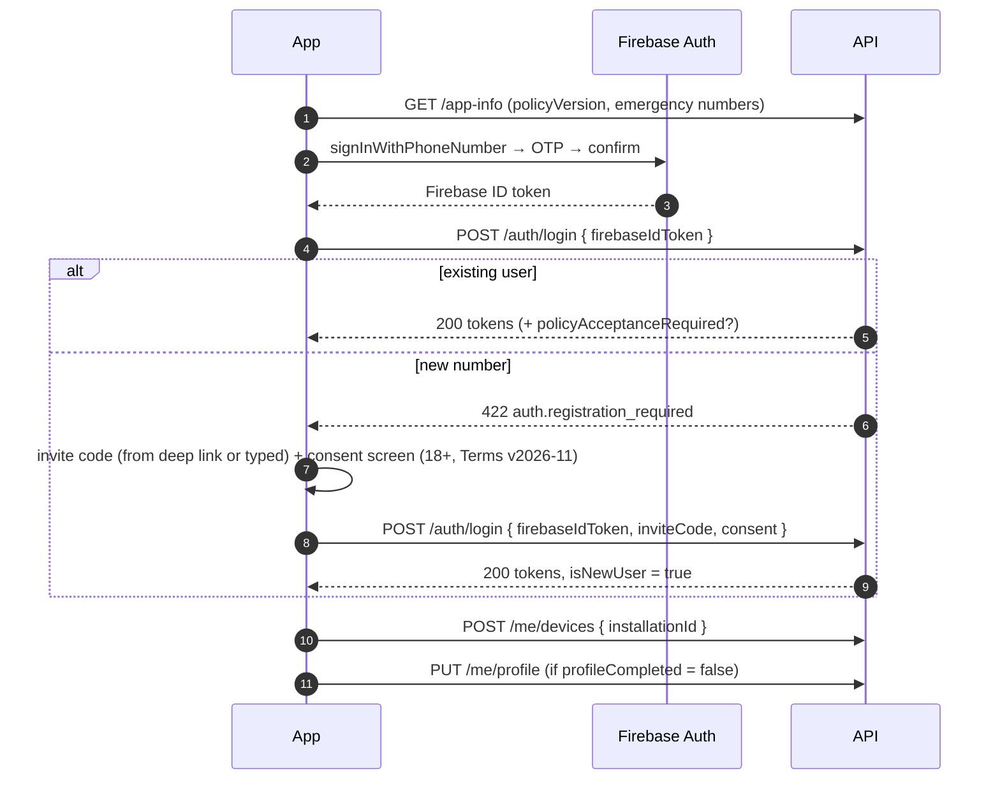

# Module 3b: Authentication and profile API

Base URL `/api/v1`. JSON uses camelCase; enums are strings; `null` fields are omitted. Errors follow the [problem+json contract](03a-api-foundation.md#error-contract-every-non-2xx-response).

## App flow



If the app already has an invite code from a deep link, it can send `inviteCode` and `consent` on the first call. Existing users who open an invite link are simply signed in, and their original referrer never changes.

**Token handling (mobile):**
- Keep the refresh token in Keychain/Keystore (`expo-secure-store`), and the access token in memory only.
- Refresh on a 401 or about 60 s before `accessTokenExpiresAt`, using a **single-flight** lock: presenting an already-rotated refresh token is treated as theft and ends the session.
- Send `User-Agent: CommunitySos/<version> (<android|ios>)`; it is recorded as the source of each consent.
- On 403 `policy.acceptance_required`, show the notice, call `POST /me/policy-acceptance`, and use the returned access token.

---

## Auth

### POST /auth/login
Anonymous, `auth` rate limit (10/min/IP).

**Existing user**
```json
{ "firebaseIdToken": "eyJhbGciOiJSUzI1NiIsImtpZCI6...", "deviceId": "a3f1c9e2-install-id" }
```

**First registration**
```json
{
  "firebaseIdToken": "eyJhbGciOiJSUzI1NiIsImtpZCI6...",
  "inviteCode": "K7QX2M9PRA",
  "consent": { "policyVersion": "2026-11", "confirmedAdult": true },
  "deviceId": "a3f1c9e2-install-id"
}
```

**200 OK**
```json
{
  "accessToken": "eyJhbGciOiJSUzI1NiIsImtpZCI6IjNmY...",
  "accessTokenExpiresAt": "2026-11-14T10:15:00Z",
  "refreshToken": "q8V1cX0m3J9wqf2b6l0hT4e7nY1sR5kP8aZ2uD6gH0E",
  "refreshTokenExpiresAt": "2026-12-14T10:00:00Z",
  "isNewUser": true,
  "user": {
    "id": "0193a1c2-d4e5-7f60-8a9b-0c1d2e3f4a5b",
    "role": "User",
    "profileCompleted": false,
    "policyAcceptanceRequired": false
  }
}
```

| Status | `code` | Meaning |
|---|---|---|
| 400 | `validation_failed` | e.g. malformed `inviteCode` |
| 401 | `auth.invalid_firebase_token`, `auth.phone_required` | OTP token bad, expired or revoked |
| 401 | `auth.account_inactive` | Suspended account |
| 404 | `invitation.not_found` | Unknown code |
| 422 | `auth.registration_required` | New number, no invite code: show the invite/consent screen |
| 422 | `auth.consent_required`, `registration.adult_required` | Consent missing / under 18 |
| 422 | `invitation.unusable` | Revoked, expired, used up, or the inviter is suspended |
| 422 | `policy.version_mismatch` | App showed an outdated notice: refetch `/app-info` |
| 409 | `duplicate` | Two registrations raced: call login again |

### POST /auth/refresh
Anonymous, `auth` rate limit.
```json
{ "refreshToken": "q8V1cX0m3J9wqf2b6l0hT4e7nY1sR5kP8aZ2uD6gH0E" }
```
**200 OK**: same shape as login, with a **new** refresh token (the old one is now invalid).

| Status | `code` |
|---|---|
| 401 | `auth.invalid_refresh_token`, `auth.refresh_expired`, `auth.refresh_reused` (all sessions in this family are revoked), `auth.account_inactive` |

### POST /auth/logout
Bearer. Revokes this device's session family, deactivates its push token, and revokes its background-location key ([06](06-background-location.md)).
```json
{ "refreshToken": "q8V1cX0m3J9wqf2b6l0hT4e7nY1sR5kP8aZ2uD6gH0E", "installationId": "cX3l9V1hS0mYw2qZ8aK4bT" }
```
**204 No Content**

---

## Me

All endpoints require a Bearer token. Those marked † also work before the current Privacy Notice is accepted.

### GET /me †
**200 OK**
```json
{
  "id": "0193a1c2-d4e5-7f60-8a9b-0c1d2e3f4a5b",
  "phoneNumber": "+919876543210",
  "role": "User",
  "fullName": "Asha Patel",
  "email": "asha@example.com",
  "bloodGroup": "B+",
  "emergencyContactName": "Ravi Patel",
  "emergencyContactPhone": "+919812345678",
  "alertsEnabled": true,
  "acceptedPolicyVersion": "2026-11",
  "referredBy": { "id": "0193a0ff-1111-7aaa-9bbb-222233334444", "fullName": "Mehta Ward Lead", "role": "SubAdmin" },
  "consents": { "termsAndPrivacy": true, "locationSharing": true, "healthData": true },
  "createdAt": "2026-11-14T10:00:00Z"
}
```
`referredBy` shows the inviter's name and role only, never their phone number.

### PUT /me/profile
Full replacement: omitted optional fields are cleared. Health fields (`bloodGroup`, `emergencyContact*`) require the `HealthData` consent. A 10-digit Indian mobile is normalised to `+91…`.
```json
{
  "fullName": "Asha Patel",
  "email": "asha@example.com",
  "bloodGroup": "B+",
  "emergencyContactName": "Ravi Patel",
  "emergencyContactPhone": "98123 45678"
}
```
**200 OK**: `ProfileResponse` (as GET /me). **422** `consent.health_data_required`.

### PUT /me/preferences
```json
{ "alertsEnabled": false }
```
**200 OK**: `ProfileResponse`.

### PUT /me/consents †
`type`: `LocationSharing` | `HealthData`. Withdrawal takes effect immediately: location withdrawal deletes the stored location; health withdrawal erases the blood group and emergency contact.
```json
{ "type": "LocationSharing", "granted": true }
```
**200 OK**
```json
{ "termsAndPrivacy": true, "locationSharing": true, "healthData": false }
```
**422** `consent.terms_not_withdrawable`: withdrawing the Terms means deleting the account.

### POST /me/policy-acceptance †
```json
{ "policyVersion": "2026-11", "confirmedAdult": true }
```
**200 OK** (replace the in-memory access token; keep the refresh token):
```json
{ "accessToken": "eyJhbGciOiJSUzI1NiIs...", "accessTokenExpiresAt": "2026-11-14T10:30:00Z" }
```
**422** `policy.version_mismatch`.

### POST /me/devices
Call after login, on every app start, and whenever Firebase reports a new installation ID (`messaging.onRegistered`). If the ID was registered by another account on the same phone, it moves to this account. Updated in Module 5 ([05](05-push-alerts.md#device-registration)):
```json
{ "installationId": "cX3l9V1hS0mYw2qZ8aK4bT", "platform": "Android", "appVersion": "1.1.0", "deviceModel": "Pixel 9" }
```
Builds released before Module 5 send `fcmToken` instead, which is still accepted. An upgraded build may send both once, and its existing row then moves to the installation ID.

**204 No Content**. **400** if neither `installationId` nor `fcmToken` is given.

### POST /me/devices/unregister †
```json
{ "installationId": "cX3l9V1hS0mYw2qZ8aK4bT" }
```
**204 No Content** (idempotent). `fcmToken` is accepted from older builds.

### GET /me/data-export †
Downloads `community-sos-data-YYYYMMDD.json` (DPDP s.11 / GDPR Art. 15 and 20):
```json
{
  "exportedAt": "2026-11-14T10:05:00Z",
  "profile": { "...": "same as GET /me" },
  "referral": { "invitationId": "…", "invitedByUserId": "…", "assignedRole": "User", "registeredAt": "2026-11-14T10:00:00Z" },
  "consents": [ { "type": "TermsAndPrivacy", "granted": true, "policyVersion": "2026-11", "capturedAt": "…", "source": "CommunitySos/1.0.0 (android)" } ],
  "devices": [ { "platform": "Android", "appVersion": "1.0.0", "deviceModel": "Pixel 9", "isActive": true, "lastSeenAt": "…" } ],
  "lastKnownLocation": { "latitude": 23.022505, "longitude": 72.571365, "accuracyMeters": 12, "capturedAt": "…" },
  "sosRequests": [ { "referenceNo": "SOS-00000123", "category": "Medical", "status": "Resolved", "history": [ { "to": "Pending", "changedAt": "…" } ] } ],
  "alertsReceived": [ { "sosReferenceNo": "SOS-00000120", "distanceMeters": 1240.5, "receivedAt": "…", "response": "OnTheWay" } ],
  "invitationsCreated": []
}
```
Device push tokens are not included (they are credentials, not personal data about the user).

### DELETE /me †
**204 No Content**. Effects, in one transaction:
- the profile is anonymised (phone becomes a `deleted:<id>` placeholder; name, email and health data are cleared; status is `Deleted`);
- the stored location, all devices and all sessions are deleted;
- withdrawal rows are added to the consent ledger;
- an audit event is written;
- after commit, the Firebase identity is deleted (best effort; a failure is logged for manual cleanup).

Referral history, SOS history and audit rows are kept, without personal values, so community records stay consistent.

| Status | `code` |
|---|---|
| 409 | `account.open_sos`: cancel or resolve an active SOS first |
| 422 | `user.cannot_delete_master` |

The same phone number can later register again, but only with a new invitation.

---

## Security and privacy notes

- **Refresh rotation:** the guard is `UPDATE … WHERE RevokedAt IS NULL` (EF concurrency token), so two concurrent refreshes cannot both succeed. Reuse of a rotated token revokes the whole family and writes a `RefreshTokenReuse` audit event.
- **Suspension:** takes effect on the next request (status cache ≤ 30 s), even with an unexpired access token.
- **Audit log:** `Login`, `Registered`, `Logout`, `RefreshTokenReuse`, `PolicyAccepted`, `ConsentChanged`, `DataExported` and `AccountDeleted` are recorded explicitly. Entity changes are recorded automatically, but personal and health fields appear only as `"***"`, so erasure leaves no copy in the 1-year audit trail.
- **Policy gate:** after `App:PolicyVersion` changes, every endpoint not marked † returns 403 `policy.acceptance_required` until the user accepts.

## Not in this module

Profile photo upload arrives with Azure Blob storage in Module 3d, and account deletion will then also delete the photo blob.
