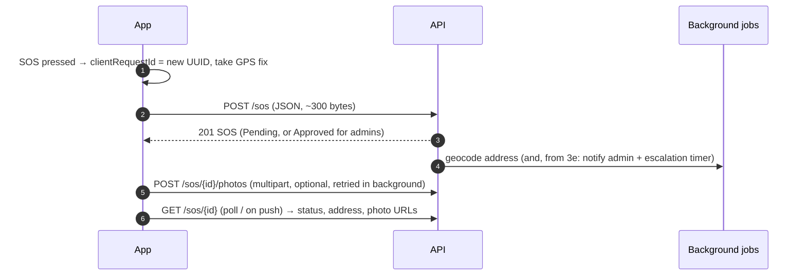

# Module 3d: SOS requests, photos and location

Base URL `/api/v1`. Conventions as in [03a](03a-api-foundation.md).

## Flow on the phone



- **The SOS is recorded first; photos follow separately.** A slow or failed photo upload never delays or loses the emergency.
- **Retries are safe.** If the network drops, resend the identical body with the **same `clientRequestId`**. The original SOS comes back with `200` and `Idempotent-Replayed: true`, so a duplicate is never created.
- **The SOS screen always shows "Call 112"** (numbers from `GET /app-info`), whatever the API returns.

## Routing

| Requester | Assigned to | Initial status |
|---|---|---|
| User | Sub-Admin who invited them, or the Master Admin if that Sub-Admin is suspended | `Pending` |
| Sub-Admin | Master Admin | `Approved` (auto, `isAutoApproved: true`) |
| Master Admin | itself | `Approved` (auto) |

There is one open SOS per person at a time (`Pending`, `Escalated` or `Approved`).

---

## POST /sos
Rate limit: 5 per 10 min per user.
```json
{
  "clientRequestId": "6c1f8a3e-2b4d-4f7a-9e0c-5d8b7a6f1e23",
  "category": "Medical",
  "description": "Elderly neighbour collapsed, needs help",
  "latitude": 23.022505,
  "longitude": 72.571365,
  "accuracyMeters": 8.5,
  "capturedAt": "2026-11-14T10:00:00Z"
}
```
`category`: `Medical` | `Fire` | `Accident` | `Crime` | `Other`. `description` is optional (≤ 1000 characters) so a panicked user can submit in one tap. `capturedAt` must be within 30 min in the past and 5 min in the future.

**201 Created** (`Location: /api/v1/sos/{id}`), as seen by the requester:
```json
{
  "id": "0193a3c4-1a2b-7c3d-8e4f-5a6b7c8d9e0f",
  "referenceNo": "SOS-00000123",
  "category": "Medical",
  "description": "Elderly neighbour collapsed, needs help",
  "location": {
    "latitude": 23.022505,
    "longitude": 72.571365,
    "accuracyMeters": 8.5,
    "mapsUrl": "https://www.google.com/maps/search/?api=1&query=23.022505,72.571365"
  },
  "status": "Pending",
  "isAutoApproved": false,
  "createdAt": "2026-11-14T10:00:01Z",
  "recipientCount": 0,
  "viewerRole": "Requester",
  "requester": { "firstName": "Asha", "id": "0193a1c2-…", "fullName": "Asha Patel" },
  "photos": [],
  "timeline": [ { "to": "Pending", "changedAt": "2026-11-14T10:00:01Z", "bySystem": false } ]
}
```
`address` appears a few seconds later, once the background geocoding job has run.

| Status | `code` | Meaning |
|---|---|---|
| 200 | - | Replay of the same `clientRequestId` (header `Idempotent-Replayed: true`) |
| 400 | `validation_failed` | Coordinates out of range, unknown category, … |
| 409 | `sos.already_open` | The body includes `"sosId"` of the active SOS: open it |
| 422 | `sos.invalid_capture_time`, `location.no_fix` | Stale GPS fix, or (0,0) |
| 422 | `sos.no_admin` | No admin available at all: the app must direct the user to 112 |
| 429 | `rate_limited` | |

## POST /sos/{id}/photos
`multipart/form-data`: the field `photos` is repeated 1–5 times (at most 5 per SOS in total). JPEG, PNG or WebP only, each under 15 MB.

```bash
curl -X POST https://api.example.com/api/v1/sos/0193a3c4-…/photos \
  -H "Authorization: Bearer $TOKEN" \
  -F "photos=@scene1.jpg;type=image/jpeg" -F "photos=@scene2.jpg;type=image/jpeg"
```
**200 OK**: the SOS detail, with:
```json
"photos": [
  { "id": "…", "url": "https://<account>.blob.core.windows.net/sos-media/sos/0193a3c4…/9f1e….jpg?sv=…&se=…&sp=r&sig=…", "width": 2048, "height": 1536, "uploadedAt": "…" }
]
```
Photo URLs are **read-only and expire after 5 minutes**; refetch the SOS for fresh ones.

| Status | `code` |
|---|---|
| 404 | Not your SOS |
| 422 | `attachment.unsupported_format`, `attachment.invalid_image`, `attachment.too_large`, `sos.too_many_attachments`, `sos.closed` |

If any photo in the request fails, none are saved and nothing is left behind in storage.

**What the server does to each photo:**
1. Caps the bytes read at 15 MB.
2. Checks the real format from its magic bytes (the client's content type and file extension are ignored).
3. Rejects images over 50 megapixels, as protection against decompression bombs.
4. Applies the EXIF orientation.
5. Downscales to at most 2048 px.
6. Flattens onto white and **re-encodes as JPEG**. This removes all EXIF data (GPS, device serial) and anything appended to the file.
7. Stores the result under a random name in a **private** container, along with its SHA-256.

## GET /sos/{id}
The response is shaped by who is asking (`viewerRole`):

| Field | Requester | Admin (assigned Sub-Admin / Master) | Alerted neighbour (`Recipient`) |
|---|---|---|---|
| category, description, location, mapsUrl, address, photos, status | ✅ | ✅ | ✅ |
| `requester` | first name, full name | + **phone, blood group, emergency contact** | **first name only** |
| `reviewRemarks`, `timeline`, `recipientCount` | ✅ | ✅ | ❌ |

A neighbour can view an SOS only while they were alerted about it **and** it is `Approved`. Afterwards, and for anyone else, the response is **404**.

Admin view excerpt:
```json
"viewerRole": "Admin",
"requester": {
  "firstName": "Asha", "id": "…", "fullName": "Asha Patel", "phoneNumber": "+919876543210",
  "bloodGroup": "O+", "emergencyContactName": "Ravi Patel", "emergencyContactPhone": "+919812345678"
}
```
Neighbour view excerpt:
```json
"viewerRole": "Recipient",
"requester": { "firstName": "Asha" }
```

## GET /sos/mine?status=&page=&pageSize=
```json
{
  "items": [
    { "id": "…", "referenceNo": "SOS-00000123", "category": "Medical", "status": "Resolved", "address": "Law Garden, Ellisbridge, Ahmedabad…", "isAutoApproved": false, "photoCount": 2, "createdAt": "…", "closedAt": "…" }
  ],
  "page": 1, "pageSize": 20, "totalCount": 1, "totalPages": 1
}
```

## POST /sos/{id}/cancel
Requester only, while the SOS is open.
```json
{ "reason": "False alarm" }
```
**200 OK**: detail with `"status": "Cancelled"`. **404** for anyone else.

## POST /sos/{id}/resolve
Requester, assigned Sub-Admin or Master Admin; the SOS must be `Approved`.
```json
{ "remarks": "Ambulance reached, patient stable" }
```
**200 OK** / **422** `sos.invalid_transition` (e.g. still Pending).

---

## PUT /me/location
Location ping from the app in use (6/min per user). Stores **only the latest fix**; requires the `LocationSharing` consent.
```json
{ "latitude": 23.0225, "longitude": 72.5714, "accuracyMeters": 15, "capturedAt": "2026-11-14T10:00:00Z" }
```
**204 No Content**. Fixes older than the stored one are ignored, so out-of-order delivery is safe. **422** `consent.location_required`, `location.stale` (> 12 h), `location.future_timestamp`.

Reports from background work go to `PUT /location/background` with a location key instead (same body and rules), so they never touch the session. See [06](06-background-location.md).

## POST /me/photo · DELETE /me/photo
Profile photo, `multipart/form-data` field `photo`, sanitised the same way as SOS photos. The previous photo blob is deleted. `GET /me` returns `profilePhotoUrl` (a 5-minute read URL). Account deletion removes the photo.

---

## Configuration

| Key | Notes |
|---|---|
| `BlobStorage:ServiceUri` | Production: `https://<account>.blob.core.windows.net`, authenticated with **Managed Identity**. The identity needs *Storage Blob Data Contributor* plus *Storage Blob Delegator* (for user-delegation SAS). |
| `BlobStorage:ConnectionString` | Local: `UseDevelopmentStorage=true` (Azurite: `npx azurite --silent --location .azurite`). |
| `BlobStorage:ContainerName` / `ReadSasMinutes` | `sos-media` / `5`. The container is created private on first use. |
| `GoogleMaps:ApiKey` | **Server key**, restricted to the *Geocoding API* and the App Service outbound IPs. If empty, addresses are simply not filled in. The mobile Maps SDK key is a separate key, restricted by app signature. |
| `Jobs:Storage` | `SqlServer` (production, schema `jobs`) or `InMemory` (local without SQL / tests) |
| `Jobs:RunServer`, `Jobs:WorkerCount` | Run the job server in the API process (default `true`); it can move to a separate worker later |

**Privacy note for the Privacy Notice:** SOS coordinates are sent to Google's Geocoding API to obtain an address. Photos never leave our storage.

## Not yet included
- Admin queue, approve/reject, escalation timer, admin push notification: Module 3e.
- 5 km alert dispatch, responder acknowledgement and "on my way" responses: Module 5.
- 90-day media retention purge: done in Module 7 (`RetentionPurgeJob`, [07](07-testing-deployment.md#retention)).
