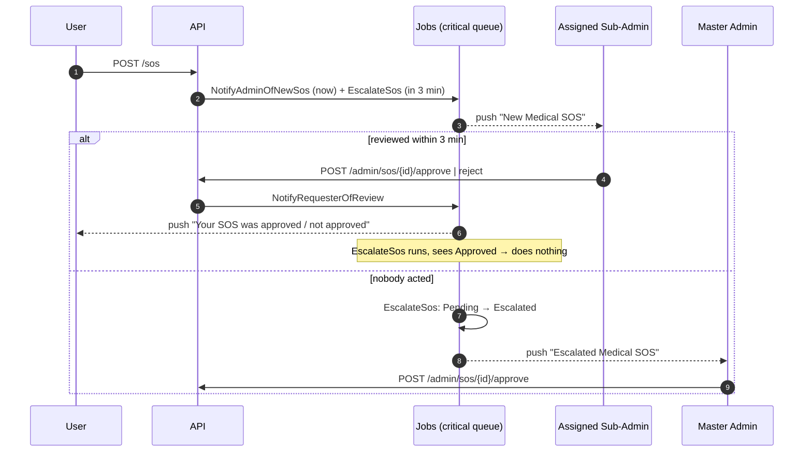

# Module 3e: Admin review, escalation, notifications, dashboard and map

Base URL `/api/v1`. Conventions as in [03a](03a-api-foundation.md).

## Workflow and timers



| Timer | Default | Setting |
|---|---|---|
| Escalation to the Master Admin | 3 min after creation | `Sos:EscalationMinutes` |
| Expire unreviewed (Pending/Escalated) | 24 h after creation | `Sos:PendingExpiryHours` |
| Expire approved but never closed | 24 h after approval | `Sos:ApprovedExpiryHours` |
| Expiry sweep | every 15 min | recurring job `expire-stale-sos` |

All jobs are **idempotent**: they re-read the SOS and do nothing if it has moved on, so job retries and duplicates are harmless. Escalation that races an approval loses cleanly, thanks to the row-version check.

**Auto-approved SOS** (raised by a Sub-Admin) skip escalation, and the Master Admin gets an "SOS raised by an admin" push. The 5 km neighbour alert for every Approved SOS arrives in Module 5, hooked into the same approval and auto-approval points.

## Push notifications

| `type` (in `data`) | To | Android channel | Title (lock screen) |
|---|---|---|---|
| `sos.review_requested` | Assigned admin | `sos-admin` | New Medical SOS |
| `sos.escalated` | Master Admin | `sos-admin` | Escalated Medical SOS |
| `sos.auto_approved` | Master Admin | `sos-admin` | Medical SOS raised by an admin |
| `sos.approved` | Requester | `sos-status` | Your SOS was approved |
| `sos.rejected` | Requester | `sos-status` | Your SOS was not approved |

The `data` payload is always `{ "type": "…", "sosId": "…", "referenceNo": "SOS-00000123" }`. The app opens `GET /sos/{sosId}` when the notification is tapped.

- **No personal data on the lock screen:** no names, descriptions, addresses or remarks. Android visibility is `PRIVATE`.
- **Delivery:** high priority on both platforms (`android.priority=high`, `apns-priority: 10`). A collapse key and tag per (type, SOS) stop a retried job from showing two banners. TTL is 1 h.
- **Dead tokens:** a token FCM reports as `UNREGISTERED`/invalid deactivates that device row immediately.
- **Retries:** if every device fails transiently, the job throws and Hangfire retries with back-off.
- **Development:** with `Firebase:UseDevelopmentVerifier=true`, pushes are logged instead of sent.

> **Done in Module 5:** devices are now addressed by **Firebase Installation ID**, and the app registers through `messaging.register()` / `onRegistered`. Legacy tokens from older builds are still delivered. See [05](05-push-alerts.md#device-registration). Module 5 also adds the 5 km neighbour alert, responder updates and closure notices to the table above.

---

## GET /admin/sos (Admin)
| Query | Meaning |
|---|---|
| `awaitingReview=true` | The review queue: Pending + Escalated, **oldest first** |
| `status=Approved` (etc.) | History filtered by status, newest first |
| `from`, `to` | Creation window `[from, to)` |
| `assignedAdminId` | Master Admin only: one Sub-Admin's SOS |
| `page`, `pageSize` | ≤ 100 |

Sub-Admins always see only SOS assigned to them.
```json
{
  "items": [
    {
      "id": "0193a3c4-…",
      "referenceNo": "SOS-00000123",
      "category": "Medical",
      "status": "Pending",
      "isAutoApproved": false,
      "requester": { "id": "…", "fullName": "Asha Patel", "role": "User", "status": "Active" },
      "requesterPhone": "+919876543210",
      "assignedAdmin": { "id": "…", "fullName": "Mehta Ward Lead", "role": "SubAdmin", "status": "Active" },
      "address": "Law Garden, Ellisbridge, Ahmedabad, Gujarat 380006, India",
      "latitude": 23.022505,
      "longitude": 72.571365,
      "photoCount": 2,
      "recipientCount": 0,
      "createdAt": "2026-11-14T10:00:01Z"
    }
  ],
  "page": 1, "pageSize": 20, "totalCount": 1, "totalPages": 1
}
```
For the full review screen (description, photos, blood group, emergency contact, timeline), call `GET /sos/{id}`; admins get the `Admin` view.

## POST /admin/sos/{id}/approve (assigned Sub-Admin or Master Admin)
```json
{ "remarks": "Called the requester and confirmed" }
```
`remarks` is optional. **200 OK**: the SOS detail (admin view) with `"status": "Approved"`.

## POST /admin/sos/{id}/reject
```json
{ "remarks": "Duplicate of SOS-00000041" }
```
`remarks` is **required** (also enforced by a DB check constraint) and is shown to the requester. **200 OK**: detail with `"status": "Rejected"`.

| Status | `code` | When |
|---|---|---|
| 400 | `validation_failed` | Missing reject remarks, remarks > 500 characters |
| 403 | `forbidden` | Caller is not an admin |
| 404 | `sos.not_found` | Not assigned to you (Sub-Admin) or does not exist |
| 409 | `concurrency_conflict` | Another admin (or the escalation job) changed it at the same instant: reload |
| 422 | `sos.already_reviewed` | Already Approved/Rejected/Cancelled/Expired |

## GET /admin/dashboard?from=&to=&adminId= (Admin)
SQL Server runs `dbo.usp_GetDashboardStats` in one round trip. Sub-Admins get their own scope (users they referred, SOS assigned to them); the Master Admin gets everything, or one Sub-Admin with `adminId`. `from`/`to` filter the SOS counts.
```json
{
  "totalUsers": 57,
  "subAdmins": 2,
  "normalUsers": 54,
  "referredUsers": 56,
  "newUsersLast7Days": 9,
  "totalSos": 31,
  "pendingSos": 1,
  "escalatedSos": 0,
  "approvedSos": 24,
  "autoApprovedSos": 3,
  "rejectedSos": 4,
  "activeSos": 2,
  "resolvedSos": 19,
  "cancelledSos": 2,
  "expiredSos": 1,
  "sosLast24Hours": 3,
  "avgReviewSeconds": 74.5
}
```
- `approvedSos` = ever approved (including ones later resolved, cancelled or expired).
- `activeSos` = currently Approved.
- `avgReviewSeconds` excludes auto-approved SOS. It is omitted when there are no reviews yet.

## GET /admin/sos/map (Admin)
`minLatitude`, `maxLatitude`, `minLongitude`, `maxLongitude` (the visible map area, required), plus optional `status`, `from`, `to`. Results are newest first, at most 1000 pins.
```json
{
  "points": [
    { "id": "…", "referenceNo": "SOS-00000123", "category": "Medical", "status": "Resolved", "latitude": 23.022505, "longitude": 72.571365, "createdAt": "…" }
  ],
  "truncated": false
}
```
`truncated: true` means there are more SOS in view: zoom in or narrow the dates. Areas crossing the 180° meridian aren't supported, which doesn't matter for India.

## Configuration

| Key | Notes |
|---|---|
| `Firebase:ProjectId`, `Firebase:ServiceAccountJson` | Shared by phone-auth verification and FCM. The service account needs the *Firebase Cloud Messaging API Admin* role. |
| `Sos:*` | Timers above |
| `Jobs:*` | See [03d](03d-sos.md#configuration). Escalation and notifications use the `critical` queue, which is processed first. |
