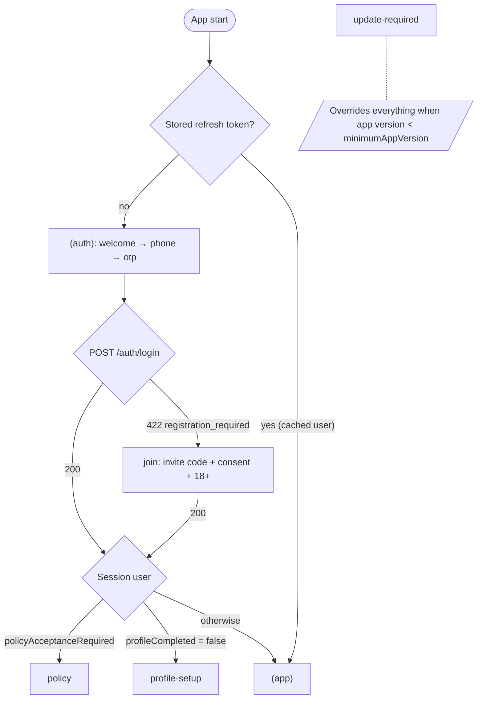

# Module 4a: Mobile foundation, sign-in and invite links

The React Native app in `mobile/`, and the invite-link site in `web/invite-site/`. How to run it: [mobile/README.md](../mobile/README.md).

## Stack

| Concern | Choice | Why |
|---|---|---|
| Framework | Expo SDK 58 (RN 0.88, React 19.3, New Architecture) | Development builds, config plugins, EAS Build and Update |
| Navigation | Expo Router, `src/app/` | File routes; `Stack.Protected` route guards; deep links come for free |
| Server state | TanStack Query 5 | Caching, retries, refetch when the app returns to the foreground |
| Session state | Zustand 5 | A tiny store that guards and non-React code can both read |
| OTP | React Native Firebase v27 (modular API), Phone Auth | Decision Q6; the API verifies the ID token |
| Secrets on device | `expo-secure-store` (Keychain / Keystore, `AFTER_FIRST_UNLOCK_THIS_DEVICE_ONLY`) | Never in backups; readable by background location work in Module 6 |
| Strings | i18next with type-checked keys | English now; Hindi and Gujarati later need only a new resource file |

All dependencies are at least two weeks old (installed with `npm_config_before`).

## Navigation and guards

All access rules live in `src/app/_layout.tsx`:

- **Offline start:** with a stored session, the app opens straight away from the cached user summary and refreshes in the background. An SOS app must never wait on the network to show its home screen.
- **Emergency numbers are always visible:** a "Call 112" bar is on every signed-out screen, and the full list from `/app-info` (with a built-in fallback) appears on home and on the update-required screen.

## Session and tokens (`src/auth/tokenManager.ts`)

| Rule (from docs/03b) | Implementation |
|---|---|
| Access token in memory only | `TokenManager.access` |
| Refresh token in the Keychain/Keystore | `secureStorage`, rotated on every refresh |
| Refresh about 60 s before expiry, or after a 401 | `getAccessToken()` skew check; `ApiClient` retries a 401 once |
| **Single-flight refresh** | One shared promise. A second use of a rotated token revokes the whole family on the server, so this is a correctness requirement, not an optimisation. |
| Refresh 401 ends the session; offline does not | `auth.*` 401 clears storage and shows the reason on the welcome screen. Network errors, 5xx and 429 keep the session. |
| A refresh finishing after sign-out is ignored | A generation counter |
| Sign-out | Gets a valid access token first (that may rotate the refresh token), then calls `POST /auth/logout` with the current refresh token, then always clears locally |
| `User-Agent: CommunitySos/<ver> (<android|ios>)` | Set by `ApiClient`; the API records it as the consent source |
| `X-Correlation-ID` per request | `ApiClient`; shown as "Reference: …" under server errors for support |

## Sign-in and registration

1. **Phone:** a 10-digit Indian mobile becomes `+91…`, or the user types a full `+` number (the same rules as the API's `PhoneInput`).
2. **OTP:** Firebase `signInWithPhoneNumber` and `confirm`. Android instant verification is handled. Resend is allowed after 30 s.
3. **Login:** the Firebase ID token goes to `POST /auth/login`. The Firebase session is then signed out, because the app runs on API tokens only.
4. **New number (422 `auth.registration_required`):** the join screen asks for the invite code, prefilled from the deep link or pasted from a WhatsApp message (the full link is accepted). It shows a live preview ("Invited by Mehta Ward Lead, you will join as a Member") and a short layered notice with links to the full Privacy Notice and Terms. Two **unticked** checkboxes, consent to the notice version and "I am 18 or older", are required before the second login call (DPDP s.6 free, specific, informed consent; s.9 the app is 18+ only).
5. **Profile setup:** the full name. Health details are optional and come later, behind their own consent (Module 4b).

**Development mode** (`EXPO_PUBLIC_AUTH_MODE=dev`, honoured in debug builds only): no SMS. Any number with code `123456` produces the `dev:+91…` token that the API accepts in its Development environment.

## Invite links

| Piece | Where |
|---|---|
| App route | `src/app/i/[code].tsx`: stores the code and continues to sign-up. Signed-in members just go home, because their referrer never changes. |
| Android App Links | `app.config.ts` intent filter `https://<INVITE_LINK_HOST>/i/*` with `autoVerify`, plus `web/invite-site/.well-known/assetlinks.json` |
| iOS Universal Links | `associatedDomains: applinks:<host>`, plus `web/invite-site/.well-known/apple-app-site-association` |
| Landing page without the app | `web/invite-site/invite.html`: the code in large type, copy button, "Open in the app" (`communitysos://i/<code>`), and store buttons. The Play link carries `referrer=invite_code=<code>`. |
| Hosting | Azure Static Web Apps (`staticwebapp.config.json` rewrites `/i/*`, sets the JSON content type for AASA, and adds strict CSP and HSTS). The host must equal the API's `App:InviteLinkBaseUrl`. |

**Before release, replace the placeholders:**
- the Play App Signing SHA-256 and the Apple Team ID in the `.well-known` files;
- the package id and App Store URL in `invite.js`.

Reading the Play Install Referrer automatically (so a fresh install skips typing the code) is a later enhancement. Until then, the join screen's paste button and the landing page's copy button cover that path.

## API change in this module

- `backend/.../launchSettings.json` gains a **`mobile-dev`** profile on `http://0.0.0.0:5180` with no HTTPS port, so emulators and phones can reach the API in Development without trusting the localhost dev certificate. Production is unchanged: HTTPS only, with HSTS.
- The example invite code `K7QX2M9PLA` in the docs contained `L`, which the code alphabet excludes; it is now `K7QX2M9PRA`, a valid code. The app's unit tests caught this.

## Tests (`npm test`, 48)

| Suite | Covers |
|---|---|
| `tokenManager.test.ts` | Single-flight under concurrency, the expiry skew, 401 ends the session, offline/5xx/429 keep it, no token, 401 after another caller already refreshed, a refresh completing after sign-out, policy token swap |
| `client.test.ts` | Headers, anonymous calls, 401 → refresh → single retry, problem+json mapping, 403 policy hook, `Retry-After`, 204, network error, timeout |
| `session.test.ts` | Login, registration with invite and consent, `409 duplicate` retry, `registration_required` keeps the phone verified, sign-out online and offline, offline bootstrap, policy acceptance |
| `parsers.test.ts` | Phone normalisation (mirrors the API), invite code alphabet and link extraction, version comparison |
| `phoneAuth.test.ts` | The dev OTP provider |

Also verified:
- `tsc --noEmit` passes with Expo Router typed routes, so every `href` is checked;
- `expo lint` is clean;
- `expo export --platform android` bundles successfully (1,344 modules).

**Not yet verified:** running on a real device or emulator. This machine has no Android SDK or Xcode. Native Firebase sign-in also needs your Firebase project files.
