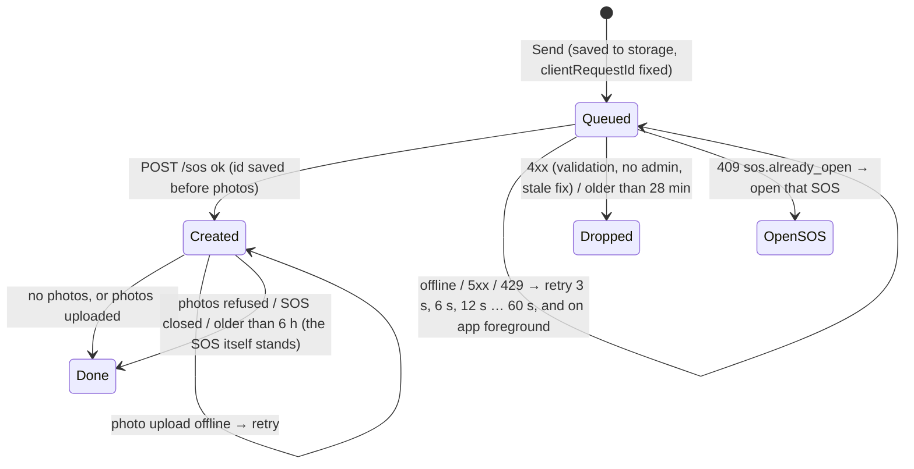

# Module 4b: Raising an SOS, history and profile (mobile)

Builds on [04a](04a-mobile-foundation.md). API contracts: [03b](03b-auth-profile.md) and [03d](03d-sos.md).

## Screens

| Route | Purpose |
|---|---|
| `(app)/index` | Home: big **SOS** button, the active SOS card (replaces the button while one is open), delivery status of a queued SOS, emergency numbers, and links to history and profile |
| `(app)/sos/new` | Raise SOS (full-screen): location status, category, optional description (≤ 1000 characters) and up to 5 photos, then **Send SOS** |
| `(app)/sos/[id]` | Detail: status with an explanation, reference, address, a map link, photos (tap for full screen), admin remarks, timeline, and **Cancel** / **Mark resolved** / **Add photos**. It also renders the **Admin** view (requester phone, blood group, emergency contact), which 4c reuses. |
| `(app)/sos/index` | My SOS history (paged, pull to refresh) |
| `(app)/profile/index` | Photo, details, nearby alerts, location sharing, health data, Privacy Notice and Terms, grievance contact, **Download my data**, **Delete my account**, sign out |
| `(app)/profile/edit` | Name, email, blood group and emergency contact (health fields are enabled only with the HealthData consent) |

"Call 112" stays visible on the home, raise-SOS and detail screens.

## Raising an SOS

1. **Location starts the moment the screen opens.** It uses a recent last-known fix (≤ 2 min old) if there is one, then a high-accuracy watch that keeps improving it.
   - The send button unlocks as soon as **any** fresh fix exists; the user is not made to wait for perfect accuracy.
   - The screen shows "±N m" while accuracy improves.
   - Fixes at (0,0), out of range, or older than 20 minutes are ignored (the API rejects fixes older than 30 minutes).
   - If permission is denied, location is off, or there's no fix after 30 s, the screen explains why and offers a fix: **Allow**, **Open Settings**, **Turn on location** (the Android system dialog), or **Try again**.
2. **Category** is required: five large buttons. Description and photos are optional, so a panicked user can send with two taps.
3. **Photos:** taken with the camera or chosen through the system picker (no media-library permission needed). Each is downscaled to 2048 px, re-encoded as JPEG (which removes EXIF and GPS data), and moved into the app's documents folder.

## Delivery: the SOS outbox (`features/sos/outbox.ts`, `sosOutbox.ts`)

An SOS must not be lost because of a dead zone or the app being killed.

- **Idempotent retries:** the same `clientRequestId` is sent on every attempt, so the API replays the original SOS instead of creating a duplicate.
- **The SOS comes first.** Photos are a separate step, and a photo failure never marks the SOS as failed.
- **Resume after a restart:** the signed-in layout reloads a pending SOS and continues.
- **Privacy:** the pending record (location and description) lives in app-sandboxed storage only until delivery, and is deleted on delivery, expiry and **every session end**: sign-out, or the server revoking or suspending the account (a `registerSignOutCleanup` hook driven by the session store).
- **What the user sees while queued:** "No connection right now. Your SOS is saved and will be sent automatically. If anyone is in danger, call 112 now." When delivery later succeeds, the screen opens the SOS detail on its own.

## Keeping status current

Until push notifications arrive in Module 5, an open SOS is polled every **15 s**: the detail screen and the home card. Photo URLs are signed for 5 minutes, so a detail with photos refreshes every 4 minutes. Images are cached by photo id, which keeps an expired URL from blanking an image already loaded.

## Profile and privacy (DPDP / GDPR)

| Control | API | Notes |
|---|---|---|
| Nearby alerts on/off | `PUT /me/preferences` | |
| Share my location | `PUT /me/consents` LocationSharing | The OS permission is requested first, and consent is recorded only if granted. One location is sent straight away; continuous updates come in Module 6. Turning it off deletes the stored location on the server. |
| Store health details | `PUT /me/consents` HealthData | Withdrawal asks for confirmation and erases the blood group and emergency contact |
| Edit profile | `PUT /me/profile` | Full replacement: the form always sends every field it keeps |
| Profile photo | `POST/DELETE /me/photo` | The same on-device resize as SOS photos |
| Download my data | `GET /me/data-export` | Saved to a temporary JSON file, opened in the share sheet, and deleted from the cache a minute later |
| Delete my account | `DELETE /me` | Confirmation dialog. `409 account.open_sos` is explained. On success the app signs out locally (the server has already revoked every session) and shows "Your account has been deleted." |

## Platform configuration added

- **Location (expo-location):** raising an SOS needs only "when in use". The permission text explains the SOS purpose. Optional background location (Module 6) is asked for separately, after an in-app disclosure ([06](06-background-location.md)).
- **Camera and photos (expo-image-picker):** the microphone permission is disabled, and `WRITE_EXTERNAL_STORAGE` is blocked.

## Tests (`npm test`: 74 in total, 26 new)

| Suite | Covers |
|---|---|
| `outbox.test.ts` | Create without photos; the SOS id is persisted before the photo upload; offline keeps everything; 5xx and 429 retry; permanent refusal cleans up; `already_open` returns the open SOS id; the 28-minute deadline; resume with photos only; photo network failure; a refused photo never fails a delivered SOS (also on resume); the photo deadline; error classification; backoff |
| `fix.test.ts` | Position conversion, rejecting (0,0) and out-of-range or NaN values, best-fix selection (accuracy vs. age, out-of-order), freshness |
| `session.test.ts` (+1) | Cleanups run on user sign-out **and** when the server ends the session |

Also verified:
- `tsc` passes, including typed routes;
- `expo lint` is clean;
- `expo export --platform android` bundles successfully (1,417 modules);
- `expo config --type prebuild` resolves the new plugins and permissions.

**Not yet verified:** running on a device. Camera, GPS and the photo upload multipart format need a real phone or an emulator.
