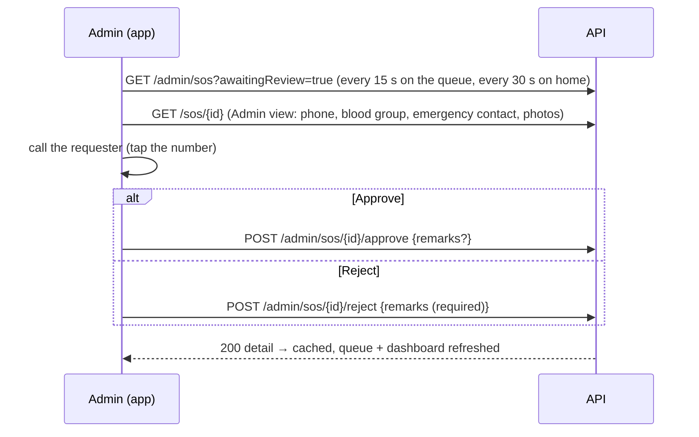

# Module 4c: Admin screens (mobile)

Builds on [04a](04a-mobile-foundation.md) and [04b](04b-mobile-sos.md). API contracts: [03c](03c-invitations-admin.md) and [03e](03e-admin-review.md). There were no backend changes.

Admins use the same app as members. Everything under `(app)/admin/` is behind a `Stack.Protected` guard: Sub-Admin or Master Admin only. The API enforces the same rules, and anything outside an admin's scope returns 404, so the guard is for usability, not security.

## Screens

| Route | Who | Purpose |
|---|---|---|
| Home (`(app)/index`) | admins | Adds a red **"N SOS waiting for your review"** card (with the escalated count) when the queue isn't empty, plus a link to the admin area. Admins keep the SOS button and everything members have. |
| `admin/index` | admins | Links to every admin screen, then the **dashboard**: SOS counts for 24 h / 7 days / 30 days / all time, the average review time, and people counts. The Master Admin sees the whole community; a Sub-Admin sees only their own scope. |
| `admin/queue` | admins | **Review queue**: Pending + Escalated SOS, oldest first, with "Waiting N min". Escalated SOS have a red border. The Master Admin also sees who each SOS is assigned to. |
| `sos/[id]` (shared) | admins | The 4b detail screen in its **Admin** view. While the SOS is Pending or Escalated it shows **Approve and alert nearby** and **Reject**. |
| `admin/sos` | admins | SOS history filtered by status. The Master Admin can open it for one Sub-Admin, from that member's screen. |
| `admin/map` | admins | **SOS map** (Google Maps): pins for the visible area, filtered by status and period, with a colour legend. Tapping a pin's callout opens the SOS. |
| `admin/invitations` | admins | Invite links, filtered by status, with **Share** (the system share sheet: WhatsApp, SMS, copy) and **Revoke** (with confirmation) |
| `admin/invitations/new` | admins | Optional label, optional sign-up limit (1–10,000), and expiry (never, 1, 7, 30 or 90 days). It then shows the code and link with **Share**. The Master Admin's links make Community Admins; a Sub-Admin's make Members. The API decides this from the caller's role. |
| `admin/users` | admins | People in scope: search by name or mobile number (debounced), plus status and role filters (role for the Master Admin). The Master Admin can open one Sub-Admin's people. |
| `admin/users/[id]` | admins | Contact (tap to call), joined date, last sign-in, who invited them and through which link, SOS raised, and alerts setting. For Sub-Admins: people invited and active links, plus links to their people and their SOS. **Suspend** (reason required) and **Reactivate** are Master Admin only. |
| `admin/referrals` | admins | Master Admin: the tree (one row per Community Admin, with active / referred members and active links). Everyone: the permanent "who joined through whom" history. |

## Review flow



| Failure (docs/03e) | What the admin sees |
|---|---|
| `409 concurrency_conflict` | "Someone else updated this SOS at the same moment…": the dialog closes and the SOS reloads |
| `422 sos.already_reviewed` | "Already reviewed or closed…": the SOS reloads, showing who decided and the remarks |
| `404 sos.not_found` | "No longer assigned to you" (for example, the Master Admin took it over after escalation) |
| `400` validation, network, 5xx | The error appears in the dialog, the text is kept, and the admin can retry |

Remarks are limited to 500 characters (the API limit). Reject requires remarks because the requester sees them.

## Map

- The visible region becomes a query box **snapped outwards to a grid of about 1/8 of the span** (`regionToBounds`). Small pans and zoom jitter produce the same box, so pins come from the cache instead of a new request. The previous pins stay visible while a new area loads.
- **Starting view:** around the admin's last known position (≤ 24 h old) if location access is *already* granted, at about 10 km across. Otherwise, the whole of India. The map screen never asks for permission.
- **More than 1,000 SOS in view** (`truncated`): a banner asks the admin to zoom in or shorten the period.
- **Pin colours** are pure hues, because Google Maps on Android tints the default pin by hue only: red = Escalated, orange = Pending, magenta = Approved, green = Resolved, blue = closed. The callout always states the status in words, and a legend sits under the map.
- **Keys:** `GOOGLE_MAPS_ANDROID_API_KEY` and `GOOGLE_MAPS_IOS_API_KEY` (see [mobile/README](../mobile/README.md#admin-sos-map-google-maps)). The `react-native-maps` config plugin is added only when a key is present, because the Android SDK crashes on first render without one. Without a key, the screen shows a notice and a link to the SOS list. Preview and production builds fail fast without both keys.

## Data and refresh (`features/admin/queries.ts`)

| Query | Refresh |
|---|---|
| Review queue | Every 15 s while the screen is open |
| Queue count (home, hub) | Every 30 s. Shared between both screens through one query key. |
| Approve / reject | The cached detail is replaced, and everything under `['admin','sos']` is invalidated (queue, lists, map, dashboard) |
| Suspend / reactivate | The cached user is replaced, and all admin queries are invalidated, because suspension also pauses links and reroutes SOS |
| Create / revoke invite | The invitation lists are invalidated |

Polling is a stopgap: Module 5 adds FCM pushes (`sos.review_requested`, `sos.escalated`), and the intervals can then be lengthened.

## Privacy

- Member screens never show health data or location (docs/03c). The reviewing admin sees them only on the SOS itself.
- Phone numbers are shown only to admins who already have them under the API scope rules, so they can call in an emergency.
- Sharing an invite sends only the link. The screen reminds the admin that anyone with the link can sign up.

## New files

```
src/app/(app)/admin/       index, queue, sos, map, invitations/{index,new}, users/{index,[id]}, referrals
src/features/admin/        logic.ts (pure helpers), queries.ts, AdminSosRow, SosMap, UserStatusPill, share.ts
src/ui/                    Chips (filters), PagedList (infinite FlatList with states), Pill
src/lib/useDebouncedValue.ts
```

Also: the admin wire types in `api/types.ts`, the `adminSosApi` / `adminUsersApi` / `invitationsApi` additions in `api/endpoints.ts`, and the `admin.*` / `home.*` strings in `i18n/en.ts`.

Dependency: **react-native-maps 1.29.11**, the version pinned by SDK 58, published 2026-09-27. It was installed with the two-week cutoff.

## Tests (`npm test`: 84 in total, 10 new)

| Suite | Covers |
|---|---|
| `features/admin/__tests__/logic.test.ts` | Minutes waited (including clock skew), average review time, period starts rounded to the minute so query keys stay stable, expiry presets, sign-up limit parsing (blank, 1–10,000, rejecting 0, decimals and negatives), map bounds (covering the view, small pans reuse the cache, clamping at the poles and the antimeridian, max > min, the India view), and approve/reject error classification |

Also verified:
- `tsc` passes, including the regenerated typed routes;
- `expo lint` is clean;
- `expo export --platform android` bundles successfully (1,473 modules);
- `expo config` adds the Maps plugin only when keys are set, and reports `extra.maps` accordingly.

**Not yet verified:** running on a device. The map rendering, share sheet, calls and the review round trip against a running API all need an emulator or a phone.
