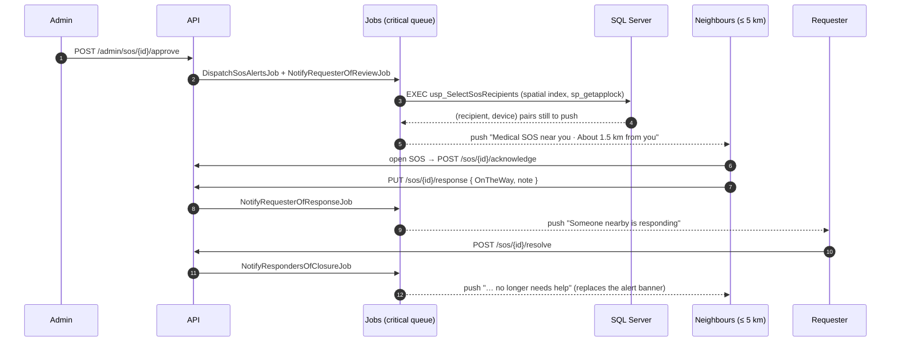

# Module 5: Push notifications and 5 km neighbour alerts

Builds on [03e](03e-admin-review.md) (admin and requester pushes) and [04a–04c](04a-mobile-foundation.md). Base URL `/api/v1`.

## What happens after approval



An admin's own SOS is auto-approved and dispatches immediately.

## Who is alerted

`dbo.usp_SelectSosRecipients` on SQL Server. Tests use a LINQ path with the same rules and haversine distance.

| Rule | Setting (`Alerts:*`) | Default |
|---|---|---|
| Last-known location within the radius of the SOS | `RadiusMeters` | 5000 |
| Location fresher than | `FreshHours` | 12 |
| Location accuracy no worse than | `MaxAccuracyMeters` | 500 |
| Active account, nearby alerts **on**, location sharing **on**, not the requester | | |
| Push attempts per recipient | `MaxAttempts` | 5 |
| FCM drops an undelivered alert after | `TimeToLiveMinutes` | 30 |

**Never twice.** A recipient row is unique per (SOS, user) (`UX_SosNotifications_Sos_Recipient`), dispatches of one SOS are serialised (`sp_getapplock`), and a re-run only returns recipients not yet delivered. Hangfire retries, duplicate enqueues and two approvals racing therefore can't double-alert anyone.

**Delivery per recipient.**
- Pushed to any of their phones → `Sent`.
- Every phone unregistered → those devices are deactivated and the recipient is `NoDevice`.
- Otherwise → `Failed`, and the job throws so Hangfire retries. Only the failed recipients are retried, up to `MaxAttempts`.

**Fresh locations.** The app sends the last-known location when it opens and on each return to the foreground, at most every 15 minutes. It does this only with location sharing on and permission already granted, and never prompts. People who turn on **background location** ([06](06-background-location.md)) also report while the app is closed. Anyone else who hasn't opened the app for 12 hours is not alerted.

## Push messages

| `type` | To | Channel | Lock screen | Collapse key |
|---|---|---|---|---|
| `sos.alert` | Neighbours | `sos-alert` (max) | "Medical SOS near you" / "About 1.5 km from you. Open the app to see if you can help." | `sos.alert:{id}` |
| `sos.responder_update` | Requester | `sos-status` | "Someone nearby is responding" / "3 people nearby are responding" | per SOS (the latest wins) |
| `sos.closed` | Everyone alerted (delivered) | `sos-status` | "Medical SOS no longer needs help" | `sos.alert:{id}`: **replaces the alert banner** |

The admin and requester messages from [03e](03e-admin-review.md#push-notifications) are unchanged.

- **No personal data on the lock screen.** Distance is rounded to 500 m steps, and no names, addresses or notes appear.
- **One multicast per distance step.** Neighbours are grouped by their distance text, which gives at most about 11 FCM calls per SOS, each covering up to 500 devices.
- The requester is pushed when someone **newly** offers help (CanHelp or OnTheWay after none or CannotHelp) or **arrives**. Switching between CanHelp and OnTheWay doesn't push again.

## Neighbour API

### GET /sos/alerts?openOnly=&page=&pageSize=
Alerts I received, newest first. `openOnly=true` returns only SOS that still need help (Approved).
```json
{
  "items": [
    {
      "sosId": "0193a3c4-…", "referenceNo": "SOS-00000123", "category": "Medical", "status": "Approved",
      "distanceMeters": 1480.2, "address": "Law Garden, Ellisbridge, Ahmedabad…",
      "alertedAt": "2026-11-15T10:00:05Z", "acknowledgedAt": "2026-11-15T10:00:40Z",
      "response": "OnTheWay", "respondedAt": "2026-11-15T10:01:02Z"
    }
  ],
  "page": 1, "pageSize": 20, "totalCount": 1, "totalPages": 1
}
```
`address` is omitted once the SOS is closed: past emergencies are not browsable by neighbours.

### POST /sos/{id}/acknowledge
**204**. Idempotent: it keeps the first time. **404** if you were not alerted.

### PUT /sos/{id}/response
```json
{ "response": "OnTheWay", "note": "Nurse, 5 minutes away, white scooter" }
```
`response` is one of `CanHelp`, `OnTheWay`, `Arrived` or `CannotHelp`, and can be changed while the SOS is open. `note` is optional, at most 300 characters, and shown to the requester and the reviewing admin. **200** returns the SOS (recipient view).

| Status | `code` |
|---|---|
| 400 | `validation_failed` (`None`, unknown response, note too long) |
| 404 | `sos.not_found` (not alerted) |
| 422 | `sos.not_active`: the SOS no longer needs help |

### GET /sos/{id}: additions
- **Recipient view:** `myAlert` `{ distanceMeters, alertedAt, acknowledgedAt, response, note, respondedAt }`. The requester appears by first name only, as before.
- **Requester and admin views:** `responders` `{ alerted, acknowledged, canHelp, onTheWay, arrived, cannotHelp, helping: [{ firstName, response, distanceMeters, respondedAt, note }] }`. Helpers are shown by first name, mirroring what they see of the requester, and never with a phone number.

## Device registration

Firebase deprecated FCM registration tokens in 2026 in favour of **Firebase Installation IDs (FIDs)**, on both the client SDKs and the Admin SDK (FirebaseAdmin 3.7: `Tokens` → `Fids`).
- **App:** React Native Firebase 27.1 with `installationIdEnabled: true`. It calls `messaging.register()`, `onRegistered(fid)` replays the cached FID and reports rotations, and the app sends `POST /me/devices { installationId }`.
- **API:** `UserDevices.InstallationId` is unique. `FcmToken` stays for builds released before this module, and the `CK_UserDevices_Target` constraint allows exactly one of the two per device. An upgraded build sending both moves its row from token to FID.
- **Sender:** FCM multicast with `Tokens` + `Fids` (answers come back tokens first, then FIDs, in request order). `Unregistered`, `SenderIdMismatch` and `InvalidArgument` deactivate the device.
- **Logout:** sends `installationId`, so the server stops pushing to that phone for that account. The phone keeps its FID registration, and the next account to sign in re-registers it.

## Mobile

| Piece | Where |
|---|---|
| Entry point registers the background handler before Expo Router (required for Android headless delivery) | `index.ts`, `features/push/background.ts` |
| Android channels `sos-alert` (max), `sos-admin` (max), `sos-status` (high); lock screen PRIVATE | `features/push/channels.ts` |
| Permission asked **in context** (home card with the reason), with Settings offered if it was refused. Profile shows the state. | `features/push/PushPrompt.tsx`, `profile/index.tsx` |
| Registration, foreground messages (in-app banner, with an urgent style for alerts and reviews), notification taps (open the SOS, also from a killed app) | `features/push/push.ts`, `InAppNotice.tsx`, `(app)/_layout.tsx` |
| Payload validation: unknown types or malformed ids are ignored, never navigated to | `features/push/payload.ts` |
| Home: "Someone near you needs help" card, and a link to **Nearby alerts** | `(app)/index.tsx`, `(app)/alerts/index.tsx` |
| Neighbour view of an SOS: safety note, **Get directions** (Google Maps), response buttons, optional note. Opening it acknowledges the alert. | `features/alerts/HelpPanel.tsx` |
| Requester and admin: **People nearby**, with counts and who is coming (first name, distance, note) | `features/alerts/RespondersSection.tsx` |
| Location heartbeat (≤ 1 per 15 min, foreground, no prompt) | `features/location/heartbeat.ts` |

**Polling becomes a safety net.** With permission granted and the device registered, the polling intervals lengthen:

| Screen | Before | With push |
|---|---|---|
| Open SOS | 15 s | 60 s |
| Review queue | 15 s | 60 s |
| Home queue count | 30 s | 2 min |
| Nearby open alerts | 30 s | 2 min |

A push can be delayed or dropped, so polling never stops entirely.

**Without Firebase** (development builds with no config files), push is reported as unavailable, no prompt is shown, and the faster polling applies.

## Privacy

- Neighbours see the requester's first name, the location, the description and photos, and only while the SOS is open. After closure they keep only the feed entry, without the address.
- The requester and admin see helpers by first name only, never their phone number.
- Response notes are erased when the helper deletes their account; the response itself stays in the SOS record. Alerts received are already part of the data export (`alertsReceived`).

## Tests

**Backend:** 148 in total (45 domain, 103 integration), 30 of them new.
- `AlertTests`: eligibility (radius edge, far, inaccurate fix, alerts off, sharing off, suspended, requester), lock-screen content and TTL, idempotent re-dispatch, auto-approved dispatch, unregistered FID leading to NoDevice plus deactivation, transient failure retrying only the failed recipient, the recipient view, acknowledgement, responses and responder pushes, when the requester is pushed, the 404/422 rules, closure notices sharing the alert's collapse key, the feed with `openOnly` and the address hidden after closure, and notes erased on account deletion.
- `MeTests` / `AuthFlowTests`: FID registration, moving from legacy token to FID, a shared phone, validation, unregister, and logout by FID.
- `AlertDomainTests`: haversine, response transitions, acknowledgement, delivery states, a single push target per device.
- `PushMessageTests`: distance text and the number of groups.

**Mobile:** 102 in total, 18 new.
- `payload.test.ts`: validation, routing, which queries to refresh, urgency.
- `heartbeat.test.ts`: throttling, no-permission, retry after failure.
- `parsers.test.ts`: distance formatting.
- `session.test.ts`: logout carries the installation ID.

Also verified:
- `dotnet build`: 0 warnings;
- `tsc` and `expo lint` are clean;
- `expo export --platform android` bundles from `index.ts` (1,553 modules);
- `expo config --type introspect` shows `FirebaseMessagingInstallationIdEnabled`, `UIBackgroundModes: remote-notification`, `aps-environment`, the Android installation-ID meta-data, the default channel and the notification icon.

**Not yet verified:**
- Real FCM delivery on Android and iOS (needs the Firebase project, an APNs key and physical devices).
- The SQL procedure against a real SQL Server; Testcontainers coverage comes in Module 7.
- The new migration applied to a database.
