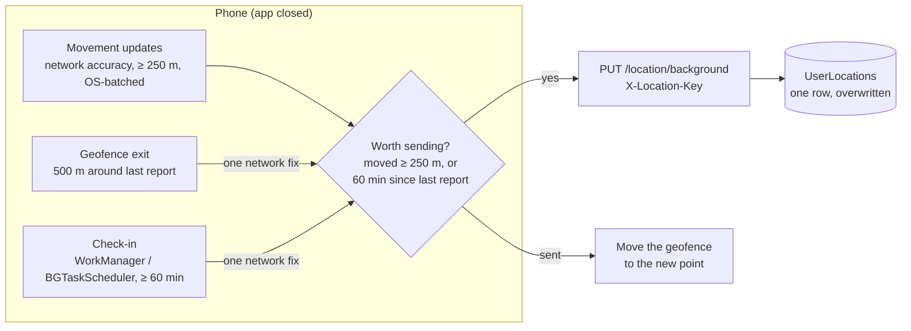

# Module 6: Background location

Builds on [05](05-push-alerts.md): neighbours are alerted only if their last-known location is within 5 km, under 12 hours old and accurate to 500 m. Until now that location was updated only while the app was open. Background location is **optional, off by default**, and turned on per phone after an in-app disclosure.

## How a phone stays fresh



| Mechanism | Covers | Notes |
|---|---|---|
| Movement updates (`startLocationUpdatesAsync`) | Someone moving around | `Accuracy.Balanced` (Wi-Fi and mobile networks, rarely GPS), `distanceInterval` 250 m, deferred 5 min / 250 m batches, iOS `pausesUpdatesAutomatically` |
| Geofence exit (`startGeofencingAsync`) | iOS pausing updates, or the app terminated by the system | One 500 m circle around the last report, exit only. **iOS relaunches a terminated app for geofence events.** |
| Check-in (`expo-background-task`) | Someone who stays put (home overnight) | Minimum 60 min. Android WorkManager runs it reliably; iOS runs it opportunistically (often overnight, when charging). |

**Why no Android foreground service.** A location foreground service would give more frequent updates, but it needs a permanent notification and the Play `FOREGROUND_SERVICE_LOCATION` declaration. Alerts only need a fix within 250 m and under 12 hours old, which Android's background limit (a few fixes per hour) already meets. `isAndroidForegroundServiceEnabled: false`.

**Battery.** There's no continuous GPS. Network-accuracy fixes are cheap, and the phone sends at most one report per 250 m moved, or one per hour when still. Nothing is sent when nothing has changed.

## Location keys: why background work doesn't use the session

Refresh tokens rotate on every use, and the API treats a reused token as theft, revoking every session of that sign-in ([03b](03b-auth-profile.md)). Background tasks get only seconds to run, and iOS can suspend the app mid-request. If the server rotated the token but the phone never saw the reply, the next refresh would look like theft and sign the person out. Done every 15 minutes, all day, that would happen regularly.

So background work uses a **location key** instead:
- **Scope:** it can only call `PUT /location/background`, nothing else. A leaked key can at worst set the owner's alert location.
- **No rotation:** a lost response does no harm.
- **Tied to the phone's session:** accepted only while the same install id still holds an active refresh token. Signing out, suspension, reuse-detection or 30 days without opening the app all stop it automatically.
- **Revoked** when background location is turned off, a new key is issued for that phone, location sharing is withdrawn (all phones), that phone signs out, or the account is deleted (rows removed).
- **Storage:** an `lk_`-prefixed 256-bit random secret; the server stores only its SHA-256. On the phone it lives in secure storage (`AFTER_FIRST_UNLOCK_THIS_DEVICE_ONLY`), so it is readable by background tasks after the first unlock and never backed up.

## API

### POST /me/location-key (signed in)
```json
{ "deviceId": "6f1c2a9e-…" }
```
**200** `{ "key": "lk_Q2x…" }`. The key is shown once. Issuing again for the same phone revokes the previous key.

| Status | `code` | When |
|---|---|---|
| 400 | `validation_failed` | `deviceId` missing or longer than 100 characters |
| 409 | `location_key.conflict` | Two issues for the same phone raced; ask again |
| 422 | `consent.location_required` | Location sharing is off |
| 422 | `location_key.unknown_device` | This install id has no active session for the account |

### POST /me/location-key/revoke (signed in)
`{ "deviceId": "…" }` → **204**. Idempotent. Allowed before accepting an updated Privacy Notice: turning collection off is always possible.

### PUT /location/background (location key)
Header `X-Location-Key: lk_…`; no bearer token is needed. Body and rules are the same as `PUT /me/location` ([03d](03d-sos.md#put-melocation)).
```json
{ "latitude": 23.0225, "longitude": 72.5714, "accuracyMeters": 35, "capturedAt": "2026-11-15T10:00:00Z" }
```
**204**. Fixes older than the stored one are ignored. Rate limit: 6 per minute per key.

| Status | `code` | The app then |
|---|---|---|
| 401 | `location_key.invalid` (missing, unknown, revoked, phone signed out, account inactive) | Stops all background work and deletes the key. The next time the app is opened while signed in, it gets a new key and restarts. |
| 422 | `consent.location_required` (the key is revoked too) | Turns background location off. |
| 422 | `location.stale` / `location.future_timestamp` | Skips that fix and keeps going. |
| 429 / 5xx / offline | | Tries again with the next fix. |

## Mobile

| Piece | Where |
|---|---|
| Task definitions, registered before Expo Router (headless launches mount no components) | `index.ts`, `features/location/background/tasks.ts` |
| Rules (best fix of a batch, when to send, what each error means, geofence) | `features/location/background/policy.ts` |
| Sending with the key, throttling, stopping on a dead key; concurrent tasks share one request | `features/location/background/reporter.ts` |
| Native start/stop, permission, geofence | `features/location/background/native.ts` |
| Turn on/off; reconcile on every app open | `features/location/background/controller.ts` |
| Disclosure and control screen | `app/(app)/location-background.tsx` |
| Home card (shown only when alerts, location sharing and notifications are already on; "Not now" hides it) | `features/location/background/BackgroundPrompt.tsx` |
| Profile row with the state | `app/(app)/profile/index.tsx` |

**Reconciling on app open** (`useBackgroundLocationSync`, run on start and on every return to the foreground):
- Turned on, permission and sharing still there: replaces a key that stopped working, and restarts tasks the OS dropped (after an Android force-stop or an iOS app-switcher swipe). After a reinstall, the person turns it on again.
- "Allow all the time" / "Always" removed in Settings: stops, and the screen offers **Open Settings**.
- Location sharing withdrawn: turns background location **off**. It is not silently resumed if sharing is turned back on later.
- Signed out (or the session ended): everything stops, and the key and state are deleted, so the next account on the phone must opt in itself.

The foreground heartbeat from Module 5 keeps running for everyone else.

### Permission flow

1. The disclosure screen explains what is collected (approximate location, also when the app is closed), why (only to choose who to alert), what is kept (only the latest location, no history, ignored after 12 h) and how to stop. Nothing is asked before **Continue**.
2. Foreground permission first if needed, then background:
   - **Android 11+** opens the app's location settings page, so the screen first says *choose "Allow all the time"*.
   - **iOS** offers *"Change to Always Allow"* once. After that, only Settings can change it.
3. Granted: a key is issued, and the tasks start. Refused: the screen offers **Open Settings**. The app still works fully in the foreground.

## Store submission

**Google Play.** Background location requires the **Location permissions declaration** in Play Console (App content → Sensitive permissions), with:
- the core feature: "alerts users when someone within 5 km raises an approved SOS, including when the app is closed";
- a short video showing the disclosure screen, the permission prompt, and an alert arriving with the app closed;
- the in-app disclosure, which must appear before the prompt (it does: `location-background.tsx`).

Use the same wording in the Data safety form: approximate and precise location, collected, not shared, used for app functionality, user can request deletion.

**App Store.** The purpose string is set in `app.config.ts` (`NSLocationAlwaysAndWhenInUseUsageDescription`). In the review notes, explain the community alert feature and that background location is optional and off by default (guidelines 5.1.1 and 5.1.5). `UIBackgroundModes` contains `location` (geofence and updates) and `processing` (check-in).

## Privacy

- Off by default, opt-in per phone, after the disclosure. One tap turns it off, from the screen or Profile and privacy.
- Same storage as before: one row per person, overwritten. No history or route, and nothing kept when location sharing is off.
- The data export lists background location per phone (`backgroundLocationKeys`: when it was turned on, last report, when and why it stopped), never the key itself.
- Withdrawing location sharing stops collection on every phone at once (keys revoked server-side) and deletes the stored location.

## Tests

**Backend:** 168 in total (49 domain, 119 integration), 20 of them new.
- `BackgroundLocationTests` (16):
  - reporting with only the key;
  - an older fix ignored;
  - a missing, unknown or refresh-style key rejected, and a bearer token alone rejected;
  - issuing requires consent and a session on that phone;
  - a new key replaces the old one, and each phone has its own;
  - turning it off (idempotent);
  - consent withdrawal stops reports and deletes the location;
  - logout revokes the key, and so does an ended phone session;
  - a stale fix is refused without revoking;
  - the export omits the key, and deletion removes the keys.
- `LocationKeyTests` (4): lifecycle, first revoke reason wins, validation.

**Mobile:** 120 in total, 18 new.
- `policy.test.ts`: haversine, best fix of a batch (out of order, inaccurate, stale, null island), the send-or-wait rule (movement, keep-alive, not newer, clock skew), error outcomes, the geofence shape.
- `reporter.test.ts`: sends with the key and moves the geofence; throttling; off or no key; a dead key halts and waits for the app; withdrawn consent turns it off; network failure keeps going and records nothing; concurrent tasks share one request.

Also verified:
- `dotnet build`: 0 warnings;
- `tsc` and `expo lint` are clean;
- `expo export --platform android` bundles (1,566 modules);
- `expo config --type introspect`: Android `ACCESS_BACKGROUND_LOCATION` and no `FOREGROUND_SERVICE_LOCATION`; iOS `UIBackgroundModes` has `location` and `processing`, `BGTaskSchedulerPermittedIdentifiers` and the Always usage string.

**Not yet verified (needs physical phones):**
- Background delivery on Android: Doze, OEM battery savers (Xiaomi, Oppo, Vivo, Samsung "sleeping apps"), and behaviour after a force-stop.
- iOS geofence relaunch, how often the check-in actually runs, and the "Change to Always Allow" prompt.
- The new migration applied to SQL Server; Testcontainers coverage comes in Module 7.
