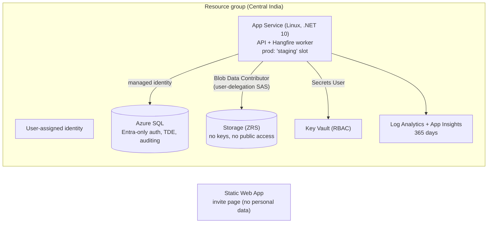

# Module 7: Testing, retention and deployment

## Test suites

| Suite | Where | Runs | What it proves |
|---|---|---|---|
| Domain | `backend/tests/CommunitySos.Domain.Tests` | everywhere | Business rules without I/O |
| API on InMemory | `backend/tests/CommunitySos.Api.IntegrationTests` | everywhere | Real HTTP pipeline (auth, validation, policies, jobs), with only outward services faked |
| **SQL Server** | same project, `SqlServer/` (trait `Category=SqlServer`) | wherever Docker or a SQL Server is available; **always in CI** | What InMemory can't: see below |
| Mobile | `mobile/src/**/__tests__` (Jest) | everywhere | Parsers, token rotation, outbox, push payloads, background location rules |

### SQL Server tests (Testcontainers)

A disposable SQL Server 2022 container (`Testcontainers.MsSql` 4.16.0), migrated with the production `DatabaseInitializer`.

| Test | Checks |
|---|---|
| `Migrations_and_scripts_are_current_and_rerunnable` | No pending migrations. A second initializer run is harmless. Procedures, triggers, the spatial index and the Hangfire `jobs` schema exist. |
| `Recipient_procedure_applies_every_eligibility_rule` | `usp_SelectSosRecipients` with real `geography` distances: inside 4.9 km yes; 5.2 km, 8 km, an 800 m accuracy fix, a 13 h old fix, sharing off, alerts off, suspended and the requester all no. |
| `Dispatch_is_idempotent_and_serialised_under_concurrency` | Three dispatches racing plus a re-run: each neighbour gets exactly one row and one push (`sp_getapplock` + unique index). |
| `Referrer_is_immutable_in_the_database` | Trigger error 51001. |
| `Audit_log_is_append_only_except_through_the_purge_gate` | UPDATE and DELETE fail with 51002. The purger deletes, then the gate is closed again on the same connection. |
| `Constraints_hold_in_the_database` | One Master Admin; one active location key per phone; `CK_UserDevices_Target`. |
| `Dashboard_procedure_returns_consistent_counts` | `usp_GetDashboardStats` scoping. |
| `Five_km_search_and_dispatch_scale_to_ten_thousand_members` | **Fan-out load test**: 10,000 members over a 16 km square, half within 4.8 km. Asserts exactly 5,000 recipients and 5,000 `Sent` rows, and prints the timings of the spatial selection and the whole dispatch job (FCM faked, 500 devices per multicast). Ceilings are generous (10 s / 60 s) for shared CI runners; read the printed numbers for capacity planning. |

```powershell
cd backend
dotnet test                                              # SqlServer tests are skipped when no Docker is found
$env:SQL_TESTS_CONNECTION = "Server=localhost;User Id=sa;Password=…;TrustServerCertificate=True"
dotnet test --filter Category=SqlServer                 # against an existing server (a throwaway database is created and dropped)
```
- `SQL_TESTS_REQUIRED=1` (set in CI) turns "skipped" into "failed", so the category can never silently stop running.
- `SQL_TESTS_IMAGE` tests another SQL Server image or CU.

> FCM's own throughput isn't load-tested; Google documents the limits. The dispatch sends one multicast per distance band of up to 500 devices, so 5,000 recipients means about 10–20 HTTP calls.

## Retention

`RetentionPurgeJob` is a recurring Hangfire job, `retention-purge`, running daily at 03:00 IST. Settings live under `Retention:*`.

| Data | Kept | Then |
|---|---|---|
| SOS photos | **90 days after the SOS closed** (`SosMediaDays`) | The blob is deleted first, then the row. A failed blob delete keeps the row and is retried the next day. The SOS record and its timeline stay. |
| Audit log | 365 days (`AuditLogDays`; at least 180 for CERT-In) | Deleted through the append-only trigger's purge gate (`SESSION_CONTEXT`), one batch at a time. |
| Ended sessions (expired or revoked refresh tokens) and revoked location keys | 30 days after ending (`EndedSessionDays`) | Deleted. A rotated token is always past its own expiry by then, so reuse detection loses nothing. |
| Deactivated push devices | 90 days unseen (`InactiveDeviceDays`) | Deleted. Active devices are never purged. |
| Last-known locations | 48 hours (`StaleLocationHours`); alerts already ignore anything over 12 hours | Deleted. |
| SOS records, status history, referrals, consent records | Not purged | These are the accountability trail. Account deletion already anonymises the person. |

The job deletes in batches (`BatchSize` 1,000, at most 100 batches per category per run), so a large first run never holds long locks.

**Backstop:** a Storage lifecycle rule deletes `sos-media/sos/*` blobs 120 days after creation, even if the job never ran. An SOS closes within about 48 hours of being raised, so this never cuts the 90 days short.

Tests: `RetentionTests` (6): photos after 90 days with the SOS kept; photos of an unclosed SOS kept; a blob-delete failure retried; sessions, keys, devices and locations; audit rows; idempotence.

## Azure (Bicep)

`infra/bicep/main.bicep` deploys one environment into one resource group. Everything holding personal data is in **Central India**. Backups are geo-redundant to the paired region, South India, so they also stay in India.



| Resource | Notable settings |
|---|---|
| Identity | User-assigned, so Bicep knows its client id (connection string) and object id (database user) before the app exists. |
| App Service | Linux `DOTNETCORE\|10.0`; `alwaysOn` (Hangfire's 3-minute escalation timer); HTTPS only; TLS 1.2; FTP and SCM basic auth off; health check `/health/live`; Key Vault references for secrets. **Prod** (P0v3) has a `staging` slot with `Jobs__RunServer=false` as a slot-sticky setting, so a warming slot never processes jobs. Staging uses B1 with no slot. |
| Azure SQL | **Entra ID-only** (no SQL logins). The admin is an Entra group containing the deploy identity. GP_Gen5_2 in prod (zone redundant), S1 in staging, never serverless auto-pause (a cold start is unacceptable for SOS). 14-day point-in-time restore, geo-redundant backups, auditing to Log Analytics. |
| Storage | ZRS, `allowSharedKeyAccess: false`, no public blob access, infrastructure encryption, 7-day soft delete, the lifecycle backstop above. |
| Key Vault | RBAC, purge protection. Secrets: `jwt-signing-key`, `firebase-service-account`, `google-maps-server-key`. |
| Monitoring | Workspace-based App Insights, 365-day retention. |
| Alerts | Email to the action group on: more than 10 HTTP 5xx in 5 min; health check below 100%; 3 or more SOS escalations in 15 min (admins not reviewing in time); 5 or more `PushDeliveryException` in 15 min (Firebase, APNs or FCM problem). |

**Least-privilege database access.** The API's identity is a contained database user with `db_datareader`, `db_datawriter` and `EXECUTE`, and nothing else: no DDL and no ownership. Schema changes, the Hangfire schema (`Jobs__PrepareSchema=false` in Azure) and the user itself are applied by the deploy step, which runs as the SQL Entra admin (`DatabaseInitializer`, settings `Database:AppPrincipal:Name` and `:ObjectId`). The user is created `WITH OBJECT_ID` (the identity's principal ID), so the SQL server needs no Microsoft Graph permissions.

**Hardening, not included:** private endpoints for SQL, Storage and Key Vault with App Service VNet integration (then disable public network access), Front Door with WAF, and Defender for Cloud plans. Each adds cost; consider them before scaling beyond a pilot.

## CI/CD (GitHub Actions)

| Workflow | Trigger | Does |
|---|---|---|
| `ci.yml` | every PR and push to `main` | **Backend:** Release build (warnings are errors) and all tests including SQL Server (Docker on the runner, `SQL_TESTS_REQUIRED=1`), plus a vulnerable-package check. **Mobile:** generate typed routes, `tsc`, lint and Jest, Android and iOS production bundles, `npm audit`. **Infra:** `az bicep build` and lint (Bicep v0.48.1). |
| `deploy.yml` | push to `main` (backend, database, infra or web changes) or manual | Tests again, publishes once, then promotes **the same package** to staging and then to prod (prod waits for the required reviewers of its GitHub environment). |
| `deploy-environment.yml` | called by `deploy.yml` | Azure login by OIDC (no stored credentials), then Bicep, then opens the SQL firewall for the runner, runs `CommunitySos.Api.dll --migrate`, closes the firewall (always), deploys the zip (prod: into the slot), smoke-tests `/health/ready` and `/app-info`, swaps (prod), and uploads the invite site. |
| `mobile-release.yml` | manual | `npm run check`, then an EAS build for the chosen profile and platform (eas-cli 27.2.0 pinned), and optionally `eas submit` (Play internal track / TestFlight). |

**Migrations are expand-then-contract.** The old version keeps running against the new schema until the slot swap. Never drop or rename a column in the same release that stops using it.

### First deployment (once per environment)

1. **Entra ID**
   - Create the group `sg-communitysos-sql-admins`.
   - Create an app registration for GitHub with **federated credentials** for `repo:<org>/<repo>:environment:staging` and `…:environment:prod`, and add its service principal to the group.
   - Give it *Contributor* and *User Access Administrator* on the resource group. The latter is needed because Bicep creates role assignments; condition it to the two roles used if your policy requires.
2. **GitHub:** create the environments `staging` and `prod` (add required reviewers to `prod`) and `mobile-release`.
   - Variables: `AZURE_CLIENT_ID`, `AZURE_TENANT_ID`, `AZURE_SUBSCRIPTION_ID`, `AZURE_RESOURCE_GROUP`.
   - Secrets: `SEED_MASTER_ADMIN_PHONE` (E.164), and `EXPO_TOKEN` in `mobile-release`.
3. Fill in the `REPLACE_ME` values in `infra/bicep/main.*.bicepparam`.
4. Create the resource groups in `centralindia` and run **Deploy** once. The API starts but fails readiness until step 5.
5. Put the secrets into Key Vault. Your user needs *Key Vault Secrets Officer* on the vault.
   ```bash
   openssl genpkey -algorithm RSA -pkeyopt rsa_keygen_bits:3072 -out jwt.pem
   az keyvault secret set --vault-name <kv> --name jwt-signing-key --file jwt.pem && shred -u jwt.pem
   az keyvault secret set --vault-name <kv> --name firebase-service-account --file firebase-sa.json
   az keyvault secret set --vault-name <kv> --name google-maps-server-key --value <key>
   az webapp restart -g <rg> -n <app>
   ```
6. **Custom domains:**
   - the API (`api.<domain>`) on App Service, with a managed certificate;
   - the invite site (`<domain>`) on the Static Web App;
   - then update `assetlinks.json` (Play app-signing SHA-256) and `apple-app-site-association` (Team ID) in `web/invite-site/.well-known`.
7. Point the mobile build at it: `EXPO_PUBLIC_API_BASE_URL` and `INVITE_LINK_HOST` in `eas.json`.

### Rollback

- **API (prod):** swap the slot back. `az webapp deployment slot swap … --slot staging --target-slot production` restores the previous build in seconds.
- **Database:** migrations are additive (expand-then-contract), so the previous API version runs on the new schema. For data loss, use Azure SQL point-in-time restore (14 days) to a new database, then repoint.
- **Mobile:** EAS Update channels (`preview` / `production`) can ship a JS-only fix. Native changes need a store release.

## Mobile release

See [08-release-checklist.md](08-release-checklist.md).
